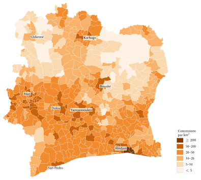
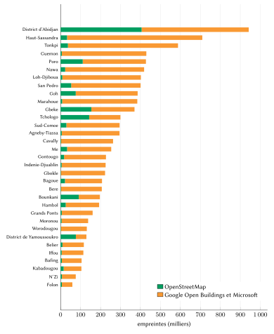
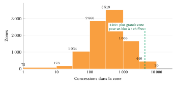
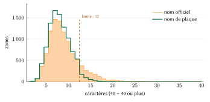
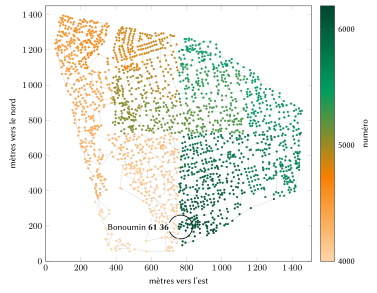

# Introduction

## Le problème

Le recensement général de 2021 a dénombré 29 389 150 résidents en Côte d'Ivoire, dont 21,5 % dans le District d'Abidjan [@rgph2021]. Très peu d'entre eux peuvent écrire une adresse qui permette à un inconnu d'arriver à leur porte. Le courrier est distribué en boîte postale, identifiée par le numéro à deux chiffres du bureau, comme dans `06 B.P. 37 ABIDJAN 06` ; la distribution à domicile n'a jamais dépassé le stade de l'essai [@upu2004civ]. Depuis 2017, le ministère de la Construction, du Logement et de l'Urbanisme (MCLU) nomme les voies et numérote les portails du District d'Abidjan dans le cadre du Projet d'Adressage du District d'Abidjan (PADA), dont les numéros métriques et le *code d'adresse* à cinq chiffres sont aujourd'hui en usage [@koaci2023numeros; @abidjanplanet2026]. Le programme exclut délibérément les quartiers précaires, où vit environ un cinquième de la population abidjanaise [@fratmat2025fin], et les villes de l'intérieur visées par le projet suivant (PAVI) n'ont pas encore reçu d'adresses [@ci2024pavi]. Ailleurs, dans les villes, les villages et les campements où vit la majorité des Ivoiriens, on trouve un logement par description et par téléphone : « après la pharmacie, deuxième ruelle à gauche, le portail bleu ».

Le coût de cette situation pèse chaque jour sur les livreurs, les équipes d'ambulance, les services d'eau et d'électricité, les banques qui doivent vérifier le domicile d'un client, et les familles qui envoient des colis à des proches. La littérature internationale range depuis longtemps l'adresse parmi les infrastructures de base d'un pays [@upu2012addressing; @farvacque2005; @un2017census] ; elle montre aussi que les programmes d'adressage s'effacent lorsque les habitants ne s'en approprient pas le résultat [@farvacque2005].

## Contribution

Cet article décrit un modèle d'adressage conçu pour la Côte d'Ivoire et émis pour l'ensemble du pays. Ses apports sont les suivants :

1. un format de code, *nom de lieu + quatre ou cinq chiffres lus par paires*, unique à l'échelle nationale à lui seul, avec l'arithmétique qui le garantit (séries nationales par nom découpées en blocs figés, section 4.5) ;
2. une numérotation des concessions le long d'une courbe de Hilbert sur chaque zone, avec des numéros réservés pour les constructions futures (sections 4.6 et 4.7) ;
3. des règles déterministes pour réduire les noms officiels trop longs en *noms de plaque* courts (section 4.3) et pour décider quels noms sont identiques (section 4.4) ;
4. un registre de 7 956 622 codes couvrant toutes les concessions visibles dans les données de bâtiments disponibles, un moteur de référence ouvert, un serveur déployable qui reproduit les réponses de l'émetteur et des vecteurs de conformité (section 5) ;
5. une évaluation mesurée du registre émis (section 6) et des estimations sourcées de ses bénéfices pour quatre catégories d'utilisateurs (sections 8 à 11).

Le modèle complète le travail de l'État. Là où le PADA, puis le PAVI, a donné une adresse à un portail, cette adresse est l'adresse officielle et s'affiche en premier, exactement comme l'État l'écrit ; le code N-Ways figure à côté, pour désigner le portail au téléphone et pour distinguer les ménages d'une cour commune derrière une même porte.

## Plan de l'article

La section 2 passe en revue les systèmes postaux, d'adressage et fonciers existants en Côte d'Ivoire ainsi que la pratique internationale. La section 3 décrit les données. La section 4 expose le modèle règle par règle, la section 5 sa mise en œuvre et la section 6 son évaluation. La section 7 présente les formes envisagées puis écartées. Les sections 8 à 11 examinent les bénéfices pour les citoyens, la logistique et le commerce, les services de secours et l'administration. La section 12 traite de la vie privée, de la sécurité et de la gouvernance, la section 13 des limites, et la section 14 conclut.

# Contexte et travaux existants

## La distribution postale

La fiche d'adressage de l'Union postale universelle pour la Côte d'Ivoire indique que la distribution se fait en boîte postale et que le code à deux chiffres du bureau doit figurer avant et après la localité [@upu2004civ]. Une variante pour la distribution à domicile, où le code du bureau est précédé d'un 1 (`104` pour une distribution à domicile par le bureau 04), y est présentée comme un essai portant sur un seul immeuble. Nous n'avons trouvé aucune description ultérieure d'un code postal. La Poste de Côte d'Ivoire a depuis lancé une boîte postale digitale et, avec l'ONECI, l'application MaPoste, qui rattache une boîte au numéro national d'identification ; cette boîte est obligatoire depuis le 1ᵉʳ mars 2026 [@osiris2026maposte; @gouv2026bulletin]. Le même bulletin fait état d'environ 5 000 coursiers indépendants inscrits sur la plateforme POLI de La Poste. La Poste promeut également what3words, un système de localisation propriétaire, depuis 2016 [@laposte2016w3w]. Aucun de ces services ne donne d'adresse à une porte.

## L'adressage des rues à Abidjan

L'adressage des rues à Abidjan a une histoire plus longue qu'on ne le croit souvent. La revue de la Banque mondiale consacrée aux programmes d'adressage des villes africaines entre 1989 et 2004 rapporte que les dix communes d'Abidjan avaient été divisées en 55 zones d'adressage désignées chacune par une lettre, les rues parallèles à la côte recevant des numéros pairs et les rues perpendiculaires des numéros impairs (« Bd A5 Latrille » à Cocody), et que les bâtiments devaient recevoir des numéros métriques qui ne furent jamais posés [@farvacque2005]. La même revue chiffre le coût des 21 programmes achevés qu'elle étudie à 0,6 dollar US par habitant et 5,7 dollars US par porte adressée, aux prix de 2005.

Le PADA, programme actuel, est conduit par le MCLU sur financement de la Banque mondiale ; les travaux de terrain ont été réalisés par IGN FI, GEOFIT et Défis & Stratégies [@ignfi_pada]. Les voies sont nommées à trois niveaux (boulevards, avenues et rues) et validées par le District, les communes et le Conseil des ministres. Le numéro est métrique : la distance en mètres depuis le début de la voie, pair d'un côté, impair de l'autre [@koaci2023numeros]. La liste officielle des dénominations validées comptait environ 11 450 voies avec leur identifiant `ID_VOIE` en septembre 2025 [@mclu2025voies]. En 2026, 14 276 voies étaient nommées et 290 805 plaques d'unités d'occupation posées, soit environ 95 % de l'objectif ; la pose des panneaux de rue a été suspendue en novembre 2025 pour corriger des malfaçons [@abidjanplanet2026]. Le code d'adresse compte cinq chiffres, trois pour le département et deux pour la commune, écrits après la voie : « Hôtel de Ville, 495, BOULEVARD DE LA REPUBLIQUE, 00217 », où 002 désigne Abidjan et 17 Le Plateau [@abidjanplanet2026]. Le programme était budgété à 12 milliards de FCFA [@fratmat2025fin] pour 348 216 unités d'occupation prévues [@koaci2025voies], soit environ 34 500 FCFA par unité. Les points d'adresse du PADA sont partagés avec des institutions partenaires en vertu d'une convention-cadre signée en janvier 2023 [@aip2023convention; @fratmat2024base] ; nous n'avons trouvé ni données ouvertes ni service public de consultation.

## Les villes de l'intérieur

Le Projet d'Adressage des Villes de l'Intérieur (PAVI) a validé son étude préliminaire pour Yamoussoukro, Daloa et Korhogo en septembre 2024 [@ci2024pavi] ; des articles plus récents y ajoutent Bouaké et visent quinze pôles régionaux d'ici 2030 [@abidjanplanet2026]. Aucune ville de l'intérieur ne disposait d'adresses à la porte au moment de la rédaction.

## Les identifiants fonciers

Les parcelles portent l'identifiant unique IDUFCI, de vingt caractères, institué par le décret 2019-221 [@decret2019221], les arrêtés de concession définitive (ACD) en ville et, en milieu rural, les certificats fonciers de l'AFOR au titre de la loi 98-750 [@afor]. La référence géodésique légale est l'ITRF2014 à l'époque 2010.0 (décret 2019-220) [@sigfu2023]. Ces identifiants désignent un terrain, non le portail auquel s'arrête un visiteur, et changent lorsqu'une parcelle est divisée ou fusionnée. Le modèle ne les utilise jamais comme adresses.

## La pratique internationale

La norme S42 de l'UPU décrit les composantes d'une adresse postale et le gabarit selon lequel un pays les combine [@upu2017s42] ; elle ne dit pas comment créer des adresses là où il n'en existe pas. L'étude de l'UPU *Addressing the world* fait de l'infrastructure d'adressage un bien public et documente plusieurs programmes nationaux [@upu2012addressing]. Le manuel de la Banque mondiale décrit la méthode classique, qui consiste à nommer les rues et numéroter les portes dans le cadre d'un programme municipal ; il en souligne les bénéfices pour les finances locales et le principal risque : une adresse que les habitants n'emploient pas est vite oubliée [@farvacque2005]. Les recommandations des Nations unies pour les recensements préconisent une identification permanente des rues et des bâtiments, « utilisable pour les recensements successifs et à d'autres fins », et observent qu'un dénombrement des logements dans les zones denses est impossible si les rues n'ont pas de nom et les bâtiments pas de numéro unique [@un2017census, para. 3.116].

## Les codes de localisation

Deux familles de codes de localisation sont largement utilisées. L'Open Location Code, ou Plus Code, code la latitude et la longitude en base 20 avec un alphabet choisi pour éviter les mots et les caractères ambigus ; un code de dix caractères désigne une maille d'environ 14 m et un code de onze caractères une maille d'environ 3 m, et le code peut être raccourci par rapport à une ville voisine [@olc]. Il est ouvert et fonctionne hors ligne. what3words nomme chaque carré de 3 m par trois mots du dictionnaire [@what3words] ; il est propriétaire, et ses mots appartiennent à une langue donnée. Ces deux codes désignent un point et non un logement : ils changent si le point de référence se déplace de quelques mètres, ne distinguent pas deux ménages derrière un même portail et se dictent mal au téléphone en français, où des lettres comme le W (« double vé ») ou le Q doivent être épelées. Nous employons donc le Plus Code pour les points (section 4.10), non comme adresse d'un logement.

## Le principe retenu : l'adresse officielle d'abord

Le modèle obéit à une règle qui prime sur toutes les autres : là où l'État a donné une adresse à un portail, c'est cette adresse qui est utilisée et affichée en premier, exactement comme l'État l'écrit. Chaque concession porte néanmoins un code N-Ways, parce que l'adresse officielle ne couvre pas les ménages d'une cour commune et parce qu'un code court se donne plus facilement au téléphone qu'un nom de voie suivi d'un numéro métrique. Dès que les points d'adresse du PADA sont partagés, ou qu'un habitant confirme la plaque de son portail, l'adresse officielle est rattachée à la concession ; aucun code N-Ways ne change. La même règle s'appliquera dans les villes du PAVI. Partout ailleurs, c'est-à-dire sur la plus grande partie du territoire, le code N-Ways est l'adresse.

# Données et sources

**Empreintes de bâtiments.** Le modèle part de 9 478 857 empreintes de bâtiments situées à l'intérieur des frontières : 1 430 500 proviennent d'OpenStreetMap [@haklay2008; @osm2026] et 8 048 357 des couches issues de l'apprentissage automatique Google Open Buildings et Microsoft Global ML Building Footprints [@sirko2021; @openbuildings; @msbuildings], lues dans la distribution Overture Maps [@overture]. La figure 2 montre la part de chaque source par région : OpenStreetMap est bien fourni dans le District d'Abidjan, le Gbêkê, le Tchologo, le Poro et le Bounkani, où des bénévoles ont tracé les bâtiments ; ailleurs, les couches automatiques apportent presque tout.

**Lieux.** Les zones sont construites sur 10 220 nœuds de lieux nommés d'OpenStreetMap (quartiers, voisinages, villages, hameaux, lieux-dits, faubourgs, villes).

**Unités administratives.** La forme machine d'un code repose sur les 510 sous-préfectures du jeu de données de référence CNTIG/OCHA [@hdx2018], identifiées par les six chiffres de leur pcode (110301 pour Bouaké), et sur les dix communes historiques d'Abidjan, qui reçoivent les codes 010111 à 010120 à l'intérieur de la sous-préfecture d'Abidjan (010101) : 520 unités au total. La figure 1 représente la densité des concessions par unité.

**Murs, clôtures et portails.** Les murs, clôtures et haies fermés d'OpenStreetMap (2 652 d'entre eux entourent au moins deux bâtiments) et ses nœuds de portail servent à regrouper les bâtiments en concessions (section 4.11).

**Population et administration.** Le chiffre de population provient des résultats publiés du recensement de 2021 [@rgph2021] ; les équipements utilisés à la section 11 proviennent du même extrait OpenStreetMap.

Toutes les données d'entrée sont ouvertes. Le dépôt recense chaque source avec sa licence et la date de consultation (`SOURCES.md`), et les outils qui ont produit le registre sont publiés avec lui [@nways_repo].

| Région | Concessions | Empreintes | Médiane (m²) |
|:--|--:|--:|--:|
| District d'Abidjan | 797 421 | 941 937 | 69,5 |
| Haut-Sassandra | 600 157 | 709 615 | 43,2 |
| Tonkpi | 491 515 | 588 017 | 36,5 |
| Guémon | 359 247 | 429 479 | 40,4 |
| Nawa | 353 610 | 418 343 | 45,1 |
| Poro | 349 550 | 427 470 | 35,3 |
| Lôh-Djiboua | 339 912 | 401 988 | 44,8 |
| San-Pédro | 338 405 | 400 569 | 45,0 |
| Gôh | 325 587 | 385 936 | 46,5 |
| Marahoué | 320 723 | 384 226 | 38,4 |
| Gbêkê | 306 189 | 370 186 | 50,8 |
| 21 autres régions, Yamoussoukro | 3 374 306 | 4 021 091 | |
| **Côte d'Ivoire** | **7 956 622** | **9 478 857** | 45,5 |

: Concessions et empreintes dans les onze régions les plus peuplées en bâtiments.

{width=88%}

{width=80%}

# Le modèle

## Les formes d'un code

Un code se présente sous plusieurs formes, chacune destinée à un lecteur différent (tableau 2).

| Forme | Exemple | Usage |
|:--------------------------|:----------------------------------|:----------------------------------------|
| Retenue | **Bonoumin · 61 36** | les personnes : dite, tapée, écrite sur un colis |
| Écrite | Bonoumin 61 36 (Cocody) | plaques, formulaires, messages ; la commune n'est qu'un repère |
| Machine | CI-010114-083-6136-2 | systèmes d'information, QR codes ; le dernier chiffre est le contrôle |
| Bâtiment, entrée | CI-010114-083-6136-2.2/1 | un bâtiment de la concession ; l'un de ses portails |
| Point | 926H+7Q7 Cocody (6CQR926H+7Q7) | tout point : son Plus Code |
| Officielle, là où le PADA a numéroté le portail | 495, boulevard de la République, 00217 | l'adresse de l'État, affichée en premier |

: Les formes d'un même code.

Soit $P$ le nom de plaque de la zone, $N$ son numéro de $n \in \{4, 5\}$ chiffres, $U$ l'unité à six chiffres, $A$ l'indice à trois chiffres de la zone dans son unité et $c$ le chiffre de contrôle. La forme retenue est $P$ suivi de « · » et des chiffres de $N$ groupés par paires à partir de la droite (6136 devient 61 36, 48480 devient 4 84 80), comme les Ivoiriens lisent les numéros de téléphone. La forme écrite ajoute entre parenthèses la commune ou la sous-préfecture, à titre de repère. La forme machine est `CI-`$U$`-`$A$`-`$N$`-`$c$. Personne n'a jamais à voir, taper ou retenir le chiffre de contrôle : il sert aux systèmes, qui le vérifient chaque fois qu'ils reçoivent une forme machine.

## Unités et zones

Une *zone* est un lieu nommé qu'emploient les habitants, à l'intérieur d'une unité. Chaque empreinte $f$ est rattachée au point de lieu le plus proche de sa propre unité $u(f)$, la distance étant mesurée dans une projection équirectangulaire locale :
$$
\operatorname{zone}(f) = \operatorname*{arg\,min}_{a \in \mathcal{A}(u(f))} \sqrt{(\varphi_f - \varphi_a)^2 + \big((\lambda_f - \lambda_a)\cos\varphi_f\big)^2},
\tag{1}
$$
où $\varphi$ et $\lambda$ sont la latitude et la longitude et $\mathcal{A}(u)$ l'ensemble des zones de l'unité $u$. Une empreinte située hors de tout polygone d'unité (11 865 cas, sur la côte et le long des frontières) prend le point de lieu le plus proche dans le pays. Les 10 220 points de lieu donnent 9 834 zones, dont 9 800 contiennent des concessions. La zone médiane compte 382 concessions et le 90ᵉ centile 1 870 ; la plus grande, la ville de Bouaflé, cartographiée par un seul point, en compte 23 047 (figure 3).

Chaque zone est figée au premier code émis : son indice, ses blocs de numéros (section 4.5) et son *cadre*, c'est-à-dire le rectangle $(x_0, y_0, x_1, y_1)$ qui englobe les points de référence de ses concessions, élargi de $0{,}0005°$ (environ 55 m) de chaque côté, sur lequel ses numéros sont disposés (section 4.6).

{width=85%}

## Noms de plaque

Beaucoup de noms officiels sont trop longs pour être dits avec un numéro : sur les 9 834 noms de zones, 1 395 dépassent douze caractères et 192 comptent plus de deux mots (« Échangeur Félix Houphouët Boigny (FHB) », « Cité Rosiers 6e Programme extension »). Chaque zone a donc deux noms : son nom officiel, conservé pour l'affichage et la recherche, et un *nom de plaque* utilisé dans le code. Une chaîne $s$ est admissible comme nom de plaque lorsque
$$
\operatorname{plaque}(s) \iff |s| \le 12 \;\wedge\; |W(s) \setminus L| \le 2 \;\wedge\; |W_{0\text{–}9}(s)| \le 1,
\tag{2}
$$
où $|s|$ compte les caractères après normalisation Unicode (une lettre accentuée compte pour un), $W(s)$ est l'ensemble des mots (le trait d'union sépare les mots), $W_{0\text{–}9}(s)$ celui des mots qui contiennent un chiffre et $L = \{$de, du, des, d', la, le, les, l', et, sur, en, au, aux, à$\}$ l'ensemble des mots de liaison, qui ne comptent pas.

Un nom qui ne satisfait pas l'éq. (2) passe par une suite d'étapes fixes, et la première qui aboutit l'emporte : (i) une forme courte déjà en usage et documentée, avec sa source (« Deux Plateaux » devient **II Plateaux**, « Gonzagueville » devient **Gonzague**) ; (ii) le nettoyage, qui retire des mots génériques comme Quartier, Cité, Lotissement, Campement ou Résidence ainsi que le texte entre parenthèses (« Cité Gestoci » devient **Gestoci**) ; (iii) « Saint » devient « St » ; (iv) la suite de mots entiers la plus distinctive, retenue automatiquement seulement si les mots supprimés sont génériques ou désignent la commune placée devant le quartier (« Koumassi remblais » devient **Remblais**). Tout autre cas est laissé à la commune, avec jusqu'à trois candidats dont le premier sert à titre provisoire : les noms de villages akan en deux parties réelles (« Amian Kouassikro »), les noms dont le dernier mot change le lieu (« Cité Angré Star 10 ») et les longs mots uniques (« Moritiendougou »). Une forme courte qui se lirait comme le nom d'une grande ville du pays ou de la région n'est jamais retenue automatiquement.

| Résultat | Zones |
|:--|--:|
| Nom officiel déjà admissible | 8 378 |
| Nettoyé | 212 |
| Abrégé (St, Ste) | 2 |
| Forme courte documentée | 2 |
| Mots les plus distinctifs | 44 |
| Laissé à la commune, premier candidat utilisé | 1 197 |
| dont encore plus long que ne l'admet l'éq. (2) | 363 |

: Obtention des noms de plaque.

Les 1 197 zones laissées à la commune portent un nom de plaque provisoire ; 826 490 codes ont été émis avec ce nom, que la commune peut remplacer une fois. Le nom officiel reste toujours un alias (1 070 alias conservés ; quatre écartés parce que deux noms de plaque les revendiqueraient), de sorte que taper « Koumassi remblais 2966 » trouve **Remblais · 29 66**. Un alias ne mène qu'à la zone qui le porte. La figure 4 compare la longueur des noms officiels et des noms de plaque.

{width=85%}

## La clé de nom

Deux lieux portent le même nom si leurs noms de plaque se réduisent à la même *clé de nom* :
$$
\kappa(s) = \operatorname{join} \circ \operatorname{fold}_{\text{lettres}} \circ \operatorname{fold}_{\text{mots}} \circ \operatorname{drop}_{L} \circ \operatorname{split} \circ \operatorname{casefold} \circ \operatorname{unaccent}(s).
\tag{3}
$$
Les étapes figurent au tableau 4. Le repliement des lettres reflète les différentes graphies françaises d'un même nom akan, mandé, krou ou gur : *Kouassikro* et *Kwassikro*, *Cocody* et *Kokody*, *Koffikro* et *Kofikro* ont la même clé.

| Étape | Règle | Exemple |
|:------------------|:----------------------------------------------------|:------------------------------|
| accents, casse | accents et majuscules supprimés ; œ devient oe | Riviéra II → riviera ii |
| découpage | sur tout caractère autre que a–z et 0–9 | N'Guessankro → n guessankro |
| articles | le, la, les, l, de, du, des, d, et, au, aux supprimés | Les Lauriers → lauriers |
| mots | st → saint, ste → sainte, pk et kilomètre → km, i à x → 1 à 10 | PK 18 = Kilomètre 18 → km 18 |
| lettres | s final supprimé (mots de quatre lettres ou plus) ; ou devant voyelle → w ; y → i ; ph → f ; qu, q → k ; c devant a, o, u → k ; lettres doubles simplifiées | Kouassikro → kwasikro |
| jonction | mots accolés | n guessankro → nguesankro |

: Les étapes de la clé de nom, éq. (3).

Le repliement ne peut que fusionner des noms, jamais séparer deux graphies d'un même nom : dans le doute, les noms partagent une série. Les 9 834 zones portent 8 618 clés distinctes ; 818 clés sont partagées par 2 034 zones qui regroupent 1 727 474 concessions. Akakro et Koffikro sont portés chacun par 16 zones, Kouadiokro par 14 et N'Guessankro par 13 ; on compte sept Madina et sept Belleville.

## Une série nationale par nom

Chaque clé de nom possède les numéros 1000 à 99999 à l'échelle nationale. Pour une clé dont les zones, prises dans l'ordre figé du code d'unité puis de l'indice de zone, comptent $c_1, \dots, c_k$ concessions, chaque zone reçoit un bloc de
$$
b(c) = \max\!\left(100,\; 100 \left\lceil \frac{2c}{100} \right\rceil\right)
\tag{4}
$$
numéros, soit le double de ses concessions arrondi à la centaine supérieure. Avec l'allocation $B = \sum_{i=1}^{k} b(c_i)$ et la réserve
$$
R = \max\!\left(500,\; \lceil 0{,}1\, B \rceil\right),
\tag{5}
$$
le nom compte
$$
n = \begin{cases}
4 & \text{si } B + R \le 9\,000 \quad (\text{blocs à partir de } 1000),\\
5 & \text{si } B + R \le 90\,000 \quad (\text{blocs à partir de } 10000),
\end{cases}
\tag{6}
$$
chiffres ; un nom qui exigerait plus de 90 000 numéros recevrait un qualificatif (le nom de son unité placé devant), ce dont aucun nom ivoirien n'a besoin. Un nom à cinq chiffres n'utilise jamais la plage $d0000$ à $d9999$ lorsque le même nom suivi du chiffre $d$ est aussi un nom, afin qu'un code tapé sans le point ne puisse se lire que d'une seule façon parmi les noms de plaque (section 4.8).

**Exemple : Bonoumin.** Deux zones de Cocody partagent ce nom, avec 1 468 et 2 193 concessions. L'éq. (4) donne $b(1468) = 100 \lceil 29{,}36 \rceil = 3000$ et $b(2193) = 100\lceil 43{,}86 \rceil = 4400$ ; les blocs sont donc 1000–3999 et 4000–8399. On a alors $B = 7400$, $R = \max(500, 740) = 740$ et $B + R = 8140 \le 9000$ : Bonoumin a quatre chiffres, et 8400–9999 constitue la réserve des futures zones de ce nom (figure 5).

**Exemple : Belleville.** Sept zones regroupant 31 339 concessions requièrent 63 000 numéros : Belleville a cinq chiffres. Comme « Belleville 1 » et « Belleville 2 » sont aussi des noms, Belleville n'utilise pas la plage 10000–29999 ; ses blocs vont de 30000 à 92999 et sa réserve de 93000 à 99999 (tableau 5, figure 5).

| Zone | Unité | Concessions | Bloc |
|:--|:--|--:|:--|
| Belleville | Abobo | 2 590 | 30000–35199 |
| Belleville | Abobo | 3 927 | 35200–43099 |
| Belleville | Yamoussoukro | 7 534 | 43100–58199 |
| Belleville | Grand-Lahou | 7 127 | 58200–72499 |
| Belleville | Zoukougbeu | 7 808 | 72500–88199 |
| Belleville | Buyo | 1 177 | 88200–90599 |
| Belleville | Dapéoua | 1 176 | 90600–92999 |
| *réserve* | | | 93000–99999 |

: La série nationale de Belleville, la plus grande série partagée.

{width=100%}

Sur les 8 618 noms, 8 295 ont quatre chiffres et 323 cinq ; 5 641 970 concessions (70,9 %) ont un numéro à quatre chiffres et 2 314 652 (29,1 %) un numéro à cinq chiffres. Une nouvelle zone portant un nom existant, ou une zone dont le bloc est plein, prend le bloc suivant au-dessus de tous les blocs de son nom dans le même espace de chiffres ; un nom à quatre chiffres dont l'espace est épuisé se poursuit dans son espace à cinq chiffres. Les blocs ne sont jamais déplacés, réduits ni renumérotés.

## La numérotation dans une zone

À l'intérieur de son bloc, les concessions d'une zone sont numérotées le long d'une courbe de Hilbert [@hilbert1891] d'ordre 16 posée sur le cadre figé. La courbe parcourt une fois chaque case d'une grille de $2^{16} \times 2^{16}$, et deux cases proches sur la courbe sont proches sur le terrain ; c'est, parmi les courbes de remplissage usuelles, celle qui préserve le mieux la proximité [@moon2001]. Des concessions voisines ont donc des numéros voisins, et un livreur qui a trouvé Bonoumin 61 36 sait que 61 40 n'est pas loin. Le point de référence d'une concession, le centre de ses bâtiments pondéré par leur surface tant que son portail n'est pas confirmé, de latitude $\varphi$ et de longitude $\lambda$, tombe dans la case
$$
g_x = \left\lfloor \frac{\lambda - x_0}{x_1 - x_0}\,(2^{16}-1) \right\rfloor, \qquad
g_y = \left\lfloor \frac{\varphi - y_0}{y_1 - y_0}\,(2^{16}-1) \right\rfloor .
\tag{7}
$$
Sa position $h$ sur la courbe s'obtient en parcourant les échelles $s = 2^{15}, 2^{14}, \dots, 1$, à partir de $h = 0$ :
$$
\begin{aligned}
&r_x = \left\lfloor g_x / s \right\rfloor \bmod 2, \qquad
r_y = \left\lfloor g_y / s \right\rfloor \bmod 2, \qquad
h \leftarrow h + s^2\,\big((3 r_x) \oplus r_y\big),\\
&(g_x, g_y) \leftarrow
\begin{cases}
(g_y,\, g_x) & \text{si } r_y = 0 \text{ et } r_x = 0,\\
(2^{16} - 1 - g_y,\; 2^{16} - 1 - g_x) & \text{si } r_y = 0 \text{ et } r_x = 1,\\
(g_x,\, g_y) & \text{si } r_y = 1,
\end{cases}
\end{aligned}
\tag{8}
$$
où $\oplus$ désigne le ou exclusif bit à bit. Les $m$ concessions d'une zone de bloc $[\ell, u]$, triées selon $h$ puis selon un identifiant stable, reçoivent
$$
N_i = \ell + i\,\delta, \qquad \delta = \max\!\left(1, \left\lfloor \frac{u - \ell + 1}{1{,}5\,m} \right\rfloor\right), \qquad i = 0, \dots, m-1,
\tag{9}
$$
ce qui laisse des intervalles entre voisins lorsque le bloc le permet ; le tiers supérieur du bloc,
$$
T = \left[\ell + \left\lfloor \tfrac{2}{3}(u - \ell + 1) \right\rfloor,\; u\right],
\tag{10}
$$
forme une réserve de fin qui n'est jamais utilisée à la première émission.

**Exemple : Bonoumin 61 36.** Le point de référence de la concession est $\varphi = 5{,}3606529$, $\lambda = -3{,}9705867$, et le cadre de Bonoumin vaut $(x_0, y_0, x_1, y_1) = (-3{,}977501 ;\ 5{,}358897 ;\ -3{,}963872 ;\ 5{,}372010)$. L'éq. (7) donne
$$
g_x = \left\lfloor \frac{0{,}0069143}{0{,}013629} \times 65\,535 \right\rfloor = 33\,247, \qquad
g_y = \left\lfloor \frac{0{,}0017559}{0{,}013113} \times 65\,535 \right\rfloor = 8\,775,
$$
et l'éq. (8) donne $h = 3\,869\,755\,712$, soit la 2 137ᵉ position parmi les 2 193 concessions ($i = 2136$). Avec $\ell = 4000$, $u = 8399$ et $m = 2193$, l'éq. (9) donne $\delta = \max(1, \lfloor 4400 / 3289{,}5 \rfloor) = 1$ et $N = 4000 + 2136 = 6136$ ; la réserve de fin de l'éq. (10) est 6933–8399. La figure 6 montre la zone entière.

{width=78%}

## Un nouveau logement

Une concession construite après l'émission, dont la position $h$ tombe entre les numéros émis $a$ (à sa position ou avant elle sur la courbe) et $b$ (après elle), prend le numéro libre strictement compris entre eux le plus proche de leur milieu, le plus petit en cas d'égalité :
$$
N^{*} = \operatorname*{arg\,min}_{N \in F,\; a < N < b,\; N \notin T} \left| N - \tfrac{a + b}{2} \right|,
\tag{11}
$$
où $F$ est l'ensemble des numéros libres des blocs de la zone. À défaut, elle prend le plus petit numéro libre de la réserve de fin $T$ ; si le bloc est plein, elle prend le premier numéro du bloc suivant de son nom (section 4.5). À Bonoumin le pas vaut 1 et les voisins ont des numéros consécutifs : une maison construite entre Bonoumin 61 34 et 61 35 reçoit Bonoumin 69 33, premier numéro de la réserve de fin. Une nouvelle concession rejoint la zone du code émis le plus proche dans un rayon de 250 m, et prend ainsi le nom de ses voisins.

## Le décodage sans contexte

Un code donné sans commune se décode par l'ensemble
$$
D(P, N) = \{\, a : \kappa(P) \in \{\kappa(a)\} \cup \operatorname{alias}(a),\; N \in \operatorname{blocs}(a) \,\},
\tag{12}
$$
qui a au plus un élément, puisque les blocs d'un même nom sont disjoints. Le texte est lu comme un nom suivi de quatre ou cinq chiffres, par paires ou non ; le « · » fixe la limite entre le nom et le numéro, et en son absence toutes les coupures sont essayées, de sorte que les noms de plaque se terminant par un nombre (« Koffikro 1 · 12 00 ») fonctionnent. Un chiffre de contrôle transmis après un tiret doit être juste, et une commune indiquée entre parenthèses ou après une virgule doit être l'unité ou le département de la zone ; sinon le code est refusé, jamais redirigé.

Les plages écartées à la section 4.5 empêchent les noms de plaque de lire les numéros les uns des autres, mais un nom officiel tapé à la place d'un nom de plaque peut lui aussi finir par un chiffre. « Air France 1 10 00 » est Air France 11000 à Korhogo, et aussi Air France I, nom officiel de la zone France I à Bouaké, suivi du numéro 1000. Lorsqu'un texte a plusieurs lectures, la commune indiquée avec lui ne garde que les lectures situées dans cette commune ou ce département ; puis une lecture par un nom de plaque passe avant une lecture par un nom officiel, car le nom de plaque est celui du code que les gens détiennent, sur la plaque, la carte et la forme écrite ; seules des lectures qui désignent encore deux codes différents sont refusées, avec la demande du « · » ou de la commune. « Air France 1 10 00 (Korhogo) » et « Air France 1 10 00 » sont donc Air France 11000, tandis que « Air France I 10 00 (Bouaké) » et « Air France 1 · 10 00 » sont France I 1000. Un numéro qui n'appartient à aucun bloc, ou qui tombe dans la réserve d'un nom, est déclaré non émis et n'est jamais deviné vers un lieu voisin.

## Le chiffre de contrôle

La forme machine porte le chiffre de contrôle de l'algorithme de Damm [@damm2004; @damm2007], calculé sur les chiffres de la clé de nom suivis du numéro. En écrivant la clé en chiffres, chaque lettre a–z devenant 10 à 35 et chaque chiffre 0–9 devenant 00 à 09, on obtient une chaîne $d_1 d_2 \dots d_K$, à laquelle on ajoute les chiffres de $N$. Avec la table de Damm $T$, un quasi-groupe totalement antisymétrique d'ordre 10,
$$
c_0 = 0, \qquad c_k = T[c_{k-1}][d_k] \quad (k = 1, \dots, K + n), \qquad c = c_{K+n},
\tag{13}
$$
$$
T = \left(\begin{array}{cccccccccc}
0&3&1&7&5&9&8&6&4&2\\ 7&0&9&2&1&5&4&8&6&3\\ 4&2&0&6&8&7&1&3&5&9\\ 1&7&5&0&9&8&3&4&2&6\\ 6&1&2&3&0&4&5&9&7&8\\
3&6&7&4&2&0&9&5&8&1\\ 5&8&6&9&7&2&0&1&3&4\\ 8&9&4&5&3&6&2&0&1&7\\ 9&4&3&8&6&1&7&2&0&5\\ 2&5&8&1&4&3&6&7&9&0
\end{array}\right),
\tag{14}
$$
les lignes étant indexées par $c_{k-1}$ et les colonnes par $d_k$, à partir de 0. Une chaîne suivie de son chiffre de contrôle est valide lorsque la récurrence aboutit à 0. Comme $T$ est totalement antisymétrique, le contrôle détecte toute substitution d'un chiffre et toute transposition de deux chiffres adjacents [@damm2007], les deux types d'erreur de transcription les plus fréquents dans l'étude classique de Verhoeff [@verhoeff1969].

**Exemple.** La clé de Bonoumin est *bonoumin*, qui devient 11 24 23 24 30 22 18 23 ; le numéro 6136 suit. La suite des $c_k$ est
3, 7, 4, 0, 1, 2, 0, 5, 4, 6, 6, 6, 8, 0, 1, 2, 1, 0, 7, 2,
d'où $c = 2$ et la forme machine CI-010114-083-6136-2. Le numéro interverti 6163 donne 8 et le numéro erroné 6137 donne 0 : tous deux sont refusés. C'est le nom, et non la zone, qui entre dans le contrôle : la zone découle du nom et du numéro par les blocs figés, si bien qu'une erreur qui tombe dans le bloc d'un autre Bonoumin est elle aussi détectée, et qu'un mauvais code d'unité ou indice de zone échoue parce que cette zone ne possède pas le numéro.

## Les codes de point

Tout point, un champ, une rive de lagune ou le lieu d'un accident sur l'autoroute, a un code de point : son Open Location Code [@olc]. Avec $\varphi' = \varphi + 90$ et $\lambda' = \lambda + 180$, les dix premiers caractères sont cinq paires de chiffres en base 20 tirés de l'alphabet `23456789CFGHJMPQRVWX`,
$$
\left(\left\lfloor \frac{\varphi' \bmod 20 r_j}{r_j}\right\rfloor,\; \left\lfloor \frac{\lambda' \bmod 20 r_j}{r_j}\right\rfloor\right), \qquad r_j \in \{20°,\ 1°,\ 0{,}05°,\ 0{,}0025°,\ 0{,}000125°\},
\tag{15}
$$
suivies d'un onzième caractère pris dans une grille de $4 \times 5$ de la dernière maille (pour la première paire, $20 r_1$ vaut $180°$ et $360°$). Pour Bonoumin 61 36, $\varphi' = 95{,}3606529$ et $\lambda' = 176{,}0294133$ donnent les paires (4, 8), (15, 16), (7, 0), (4, 11) et (5, 15), soit 6C QR 92 6H 7Q, puis le caractère de grille 7 : le code est `6CQR926H+7Q7`, une maille d'environ 2,8 m sur 3,5 m (figure 7). Le code s'écrit en forme courte par rapport à la plus proche des villes de référence des 520 unités, selon la règle de l'Open Location Code : quatre caractères sont omis à moins de $0{,}3°$ de la ville, six à moins de $0{,}015°$ et huit à moins de $0{,}00075°$. Le point de référence de Cocody est à $0{,}024°$ : la forme courte est `926H+7Q7 Cocody`. Le décodage préfixe les premiers caractères propres à la ville et décale d'une maille lorsque le résultat est à plus d'une demi-maille.

Puisque la ville complète la forme courte, deux villes ne s'écrivent jamais de la même façon. Cinq noms sont la ville de référence de deux unités chacun (Lolobo, Santa, Nafana, Guézon et N'Guessankro, ce dernier sous deux graphies) ; chacune de ces dix villes s'écrit donc avec son département entre parenthèses, comme le pays distingue les homonymes : `QHW6+44J Lolobo (Béoumi)`, jamais `QHW6+44J Lolobo`, qui pourrait aussi se décoder par rapport à Lolobo (Attiégouakro), 0,8° plus au sud. Les accents, la casse et la ponctuation de la ville sont indifférents. Un code court tapé avec la ville seule est décodé par rapport à chaque ville de ce nom, et une lecture n'est retenue que si l'émetteur l'aurait écrite : la ville est, à $0{,}0001°$ près, la référence la plus proche de la maille obtenue, et la maille raccourcie par rapport à elle redonne les caractères tapés. S'il reste exactement une lecture, elle est décodée ; sinon le code est refusé. La vraie lecture passe toujours ce test : la règle peut refuser, jamais rendre une mauvaise maille. Seule la ville écrite après ces codes est concernée ; le Plus Code lui-même, et chaque code, numéro et chiffre de contrôle, sont ceux qui ont été émis.

{width=68%}

## Les concessions

L'unité de l'adresse est la concession (la parcelle ou la cour), non le bâtiment, car le visiteur a besoin du portail. Les empreintes sont regroupées en concessions zone par zone, après un tri selon un identifiant stable, selon les règles du tableau 6, où la distance entre deux empreintes est
$$
\operatorname{dist}(a, b) = \min_{p \in \partial a,\; q \in \partial b} \lVert p - q \rVert,
\tag{16}
$$
la plus courte distance entre leurs contours, nulle lorsque l'une touche ou chevauche l'autre.

| Règle | Condition | Effet |
|:--------------|:----------------------------------------------|:----------------------------------------|
| Enceinte | le centre de l'empreinte est dans un mur, une clôture ou une haie fermés cartographiés de 40 à 6 000 m² | l'enceinte forme une concession |
| Cité | dans une enceinte plus grande : cité, site administratif, militaire ou de police | un parent ; les concessions qu'il contient gardent leurs codes |
| Annexe | une empreinte de moins de 25 m² (cuisine, douche, guérite) | rejoint l'empreinte de 25 m² ou plus la plus proche, à moins de 5 m selon l'éq. (16) |
| Isolée | toute autre empreinte | sa propre concession |

: Règles de regroupement.

Seules les annexes se rattachent, et seulement à un bâtiment d'au moins 25 m² : deux maisons ne sont jamais réunies et rien ne s'enchaîne. Le résultat est de 7 956 622 concessions pour 9 478 857 empreintes, soit 1,19 empreinte par concession : 6 670 716 isolées, 1 282 106 avec leurs annexes et 3 800 issues de murs cartographiés ; 6 671 864 concessions comptent un bâtiment, 1 089 065 deux, 164 804 trois et 30 889 quatre ou plus. Fusionner deux codes plus tard ne coûte rien à un ménage, alors que défaire une fusion erronée donnerait un nouveau code à l'un d'eux ; c'est pourquoi les règles sont prudentes, et les réponses des habitants dans l'application (« ces bâtiments sont une seule maison », « voici le portail ») les complètent.

## Le profil du bâtiment

Chaque bâtiment porte une classe d'usage avec sa confiance et sa source, sa taille, son nombre de niveaux lorsqu'il est connu et un statut. Les classes reprennent les types ivoiriens : résidentiel (villa, logement de cité, immeuble, cour commune, baraque, case), commercial (boutique, maquis, marché, station-service, banque, pharmacie), bureau, administration, enseignement, santé, culte, hôtellerie, transport, industrie, agriculture, annexe, en construction et ruine. Elles sont déduites dans un ordre fixe : le type de bâtiment OpenStreetMap (confiance 0,85), une étiquette d'équipement, de commerce, de bureau ou de tourisme sur l'empreinte (0,75), un lieu cartographié à l'intérieur (0,65), la taille de l'empreinte (0,3 à 0,4), et à défaut résidentiel (0,45). Quatre-vingt-dix-neuf pour cent des 9 478 857 classes sont encore la valeur par défaut ; OpenStreetMap donne le nombre de niveaux de 4 035 bâtiments. Les hauteurs des empreintes automatiques ne prennent que 36 valeurs distinctes entre 3,5 et 7 m et ne sont pas utilisées. Un logement ne porte jamais de nom.

# Mise en œuvre

## Le moteur de référence

Les règles normatives sont écrites dans `engine/SPEC.md` et mises en œuvre dans un moteur de référence en Python, limité à la bibliothèque standard (`engine/reference/ci_engine.py`), accompagné des règles de noms de plaque (`plate_names.py`). Le moteur lit toutes les formes d'un code, calcule la clé de nom et le chiffre de contrôle, code et décode les Plus Codes, trouve l'unité et la zone d'un point et reproduit la numérotation des éq. (7) à (11). Il est livré avec le registre figé des zones (`engine/data/register.json` : 520 unités avec leurs villes de référence, 8 618 noms avec leurs blocs, 9 834 zones avec leurs noms de plaque, noms officiels, blocs et cadres, et 1 070 alias) et la frontière nationale, quelques mégaoctets au total : un décodeur peut fonctionner hors ligne sur un téléphone.

## Le registre

Le registre (`registry/`) contient chaque code émis, en un fichier CSV compressé par gzip par unité, plus la table figée des zones `areas.csv.gz`. Chaque ligne donne les formes machine, retenue et écrite, la zone et son nom officiel, le numéro et le chiffre de contrôle, le statut (`provisional` jusqu'à la confirmation par les habitants), le mode et la date d'émission, la position et le type de l'entrée, le Plus Code, l'éventuelle adresse officielle, la classe d'usage, le type, les bâtiments et la surface de plancher, ainsi que la règle de regroupement. Un manifeste (`MANIFEST.json`) donne le nombre de codes par unité et l'empreinte SHA-256 de chaque fichier décompressé. Le registre est publié intégralement et il est le même pour tous les quartiers.

## Le serveur et son API

Le dépôt comprend un serveur (`server/`) que chacun, ministère, poste ou développeur, peut déployer en une commande (`docker compose up`). Il est écrit en Python avec la seule bibliothèque standard et SQLite, et réutilise le moteur de référence. Sa commande `import` charge le registre dans une base en vérifiant chaque fichier contre le manifeste et refuse toute divergence ; sa commande `export` réécrit le registre au format publié, et l'export d'un registre importé est identique octet pour octet aux fichiers publiés une fois décompressés. L'API JSON sous `/v1` donne la fiche complète d'un code, la recherche par toute forme (retenue, écrite, machine, adresse officielle ou code de point), le code à un point et les codes voisins, la vérification d'une forme machine, le codage et le décodage des codes de point, ainsi que les unités, zones et codes de chaque zone. Un déploiement émetteur ajoute `POST /v1/codes` et `PATCH /v1/codes/{machine}`, qui appliquent les règles de l'émetteur : un point à moins de 3 m d'une entrée émise a déjà un code ; un contour doit couvrir de 6 à 20 000 m² ; une porte supplémentaire doit être à moins de 80 m de sa concession ; une nouvelle concession rejoint la zone du code le plus proche dans un rayon de 250 m ; et son numéro est donné par l'éq. (11). L'API est spécifiée en OpenAPI 3.1 (`server/openapi.yaml`) et documentée avec des requêtes et réponses réelles (`docs/api.md`).

Un seul émetteur peut exister par pays : deux émetteurs travaillant sur le même registre donneraient le même numéro à deux concessions différentes. Un déploiement fonctionne donc en lecture seule, sauf si l'État ou N-WAYS LIMITED l'a désigné comme émetteur.

## Conformité

Toute implémentation du moteur doit reproduire deux jeux de vecteurs : `engine/reference/vectors.json` (625 clés de nom, 500 formes de code, 2 812 recherches, 400 codes de point, 120 codes de point courts écrits par rapport à une ville dont le nom est aussi celui de la ville d'une autre unité, numérotation, blocs d'extension, positions de Hilbert, tailles de bloc et paires de chiffres, calculés sur le registre figé) et `engine/reference/test_vectors.json` (points réels, cas de test publics de l'Open Location Code, contrôles de Damm, noms qui doivent ou ne doivent pas partager une série, numéros non émis et cas d'alias). Les 40 tests unitaires du moteur et les 28 tests du serveur sont exécutés à chaque modification, et `tools/check-decoding.py` décode chaque code émis du registre à partir de chacune des formes que les gens détiennent. Les tests du serveur comprennent 310 émissions successives calculées par le moteur de l'émetteur lui-même sur cinq zones de test, y compris des blocs qui se remplissent et prennent un bloc d'extension ; le serveur reproduit chaque numéro et chaque forme.

# Évaluation

Nous avons mesuré le registre émis tel qu'il est publié, au moyen d'un script inclus dans le dépôt (`tools/paper-evaluation.py`), en lisant une fois chacune des 7 956 622 lignes. Les mesures de décodage et d'erreurs portent sur un échantillon aléatoire fixe de 100 000 codes (graine 2026).

## Conformité, couverture et unicité

Chaque ligne est conforme au moteur de référence : son numéro appartient aux blocs de sa zone, son chiffre de contrôle est celui de l'éq. (13), et ses formes retenue et écrite ainsi que son Plus Code sont ceux qu'écrit le moteur (0 échec). Les 7 956 622 formes machine sont toutes distinctes, de même que les 7 956 622 couples $(\kappa(P), N)$ : la forme retenue désigne une seule concession dans tout le pays. Chaque concession présente dans les données a un code ; la couverture du registre n'est limitée que par celle des empreintes (section 13).

## Longueurs

| Mesure | Valeur |
|:--|--:|
| Codes à numéro de quatre chiffres | 5 641 970 (70,9 %) |
| Codes à numéro de cinq chiffres | 2 314 652 (29,1 %) |
| Forme retenue, longueur moyenne | 16,4 caractères |
| Forme retenue, plus courte et plus longue | 10 et 34 caractères |
| Code de point court de 8 caractères (plus la ville) | 6 330 711 (79,6 %) |
| Code de point court de 6 ou 4 caractères | 1 625 532 (20,4 %) |
| Code de point complet (aucune ville à moins de 0,3°) | 379 |

: Longueur des codes émis.

Les formes retenues les plus longues correspondent aux noms provisoires des zones laissées à leur commune ; parmi les autres, la plus longue est « Soungalovogo · 1 00 00 », 22 caractères. Quatre chiffres forment deux groupes, bien en deçà des trois à cinq groupes que retient la mémoire à court terme [@cowan2001].

## Décodage

Nous avons décodé chaque forme de chaque code de l'échantillon, sans autre information, et compté combien de fois le décodeur retrouve le code d'origine (tableau 8).

| Forme décodée | Échantillon | Décodée vers le même code |
|:--------------------------------------------------|--------------------:|------------------------------:|
| Retenue (avec « · ») | 100 000 | 100 000 (100 %) |
| Machine | 100 000 | 100 000 (100 %) |
| Écrite (sans point, commune entre parenthèses) | 100 000 | 100 000 (100 %) |
| Code de point court, retrouvé à moins de 3 m de l'entrée | 100 000 | 100 000 (100 %) |

: Allers-retours sur l'échantillon aléatoire.

Chaque code de l'échantillon est retrouvé à partir de chacune de ses formes, et un passage sur le registre entier (`tools/check-decoding.py`) décode les 7 956 622 formes retenues, formes écrites et codes de point courts avec leur ville vers leur propre code et leur propre maille. Deux règles de la section 4 portent ce résultat là où un texte pourrait se lire de deux façons. Pour 6 840 codes d'Air France (0,09 %), à Korhogo et à Man, la forme écrite sans le « · » se lit aussi comme Air France I ou Air France II, noms officiels de France I et de France II à Bouaké, suivis de quatre chiffres ; la lecture par le nom de plaque passe en premier, et la commune entre parenthèses la confirme (section 4.8). Et 79 412 codes (1,0 %) sont écrits par rapport à l'une des dix villes de référence qui portent leur département parce que la ville d'une autre unité a le même nom (section 4.10) ; sans le département, un décodeur ne pourrait pas distinguer les deux Lolobo. L'erreur médiane des codes de point courts retrouvés est de 1,2 m et le 99ᵉ centile de 2,1 m, à l'intérieur de la maille de onze caractères.

## Erreurs dans le numéro

Pour chaque code de l'échantillon, nous avons produit toutes les substitutions d'un chiffre de son numéro et toutes les transpositions de deux chiffres adjacents distincts (en gardant un premier chiffre non nul), puis classé le résultat.

| Erreur | Variantes | Autre logement | Dans un bloc, non émis | Hors des blocs | Détectée |
|:------------------|--------------:|------------------:|------------------:|------------------:|--------------:|
| Substitution | 3 759 209 | 71,8 % | 10,3 % | 17,9 % | 100 % |
| Transposition adjacente | 272 996 | 67,8 % | 14,0 % | 18,1 % | 100 % |

: Effet d'une seule erreur dans le numéro, et ce que détecte le chiffre de contrôle.

Parmi les substitutions, 2 699 858 mènent à un autre logement émis, 387 447 tombent dans un bloc sur un numéro non émis et 671 904 hors de tout bloc ; pour les transpositions, 185 202, 38 246 et 49 548. Les blocs étant denses, environ sept erreurs sur dix enverraient un visiteur vers un logement réel mais erroné. C'est la justification mesurée d'un chiffre de contrôle dans toute forme machine : un système qui reçoit `CI-010114-083-6163-2` au lieu de `CI-010114-083-6136-2` le refuse. Soit $p_{\text{faux}}$ la probabilité qu'une erreur non contrôlée mène à un autre logement ; avec un chiffre de contrôle qui détecte toutes les substitutions et transpositions adjacentes, la probabilité résiduelle pour ces erreurs vaut
$$
p_{\text{faux}}^{\text{contrôlé}} = p_{\text{faux}} \times \Pr[\text{non détectée}] = 0{,}718 \times 0 = 0,
\tag{17}
$$
ne laissant que des erreurs plus rares, comme deux fautes indépendantes, dont un chiffre de contrôle décimal laisse passer environ une sur dix.

## Séries nationales et numérotation par zone

Pour mesurer l'apport des séries nationales, nous avons numéroté chaque zone isolément à partir de 1000, avec les mêmes règles de bloc et de pas, éq. (4) et (9). Dans ce scénario, 991 213 codes (12,5 %) partageraient leur forme retenue avec un code d'une autre zone du même nom, et chacun aurait besoin de sa commune pour être compris. Avec les séries nationales, leur nombre est nul, au prix d'un cinquième chiffre pour 29,1 % des concessions au lieu des 21,1 % qui vivent de toute façon dans des zones trop grandes pour un bloc à quatre chiffres (230 zones de plus de 4 500 concessions, regroupant 1 681 123 concessions).

## Regroupement

Nous avons relancé les règles de regroupement en leur masquant les 2 652 murs et clôtures cartographiés qui entourent au moins deux bâtiments, puis comparé le résultat aux enceintes. 4,5 % des enceintes sortent entières (4,0 % exactement) et 34,1 % ne manquent que d'un bâtiment. Derrière un mur ivoirien, la maison principale, le boys-quarter et les chambres des locataires sont des bâtiments distincts, à plusieurs mètres les uns des autres ; sans mur cartographié, les règles les laissent séparés à dessein (section 4.11). Le regroupement est donc la partie la moins sûre du registre, et c'est elle que les confirmations des habitants doivent corriger.

## Codes près de lieux connus

| Près de | Retenue | Machine | Point |
|:------------------|:------------------------|:------------------------------|:--------------------------|
| Riviera, Cocody | Bonoumin · 61 36 | CI-010114-083-6136-2 | 926H+7Q7 Cocody |
| Hôtel de Ville, Le Plateau | Le Plateau · 1 13 10 | CI-010116-002-11310-8 | FH+RQX Le Plateau |
| Marché de Treichville | Zone 2b · 11 21 | CI-010119-010-1121-2 | XR+JJ5 Treichville |
| Gare d'Abobo | Abobo RTI · 29 21 | CI-010111-035-2921-0 | 9J+59F Abobo |
| Koumassi Remblais | Remblais · 29 66 | CI-010115-005-2966-3 | 2P+565 Koumassi |
| Adjouffou, Port-Bouët | Adjouffou · 4 84 80 | CI-010118-021-48480-1 | 63VH+FJ5 Port-Bouët |
| Bouaké, grand marché | Bouaké · 25 45 | CI-110301-096-2545-5 | Q9+RQV Bouaké |
| Basilique, Yamoussoukro | Petit Bouaké · 11 15 | CI-020201-031-1115-9 | RP63+F6V Yamoussoukro |
| Korhogo | Korhogo · 1 08 32 | CI-280201-041-10832-8 | 5C+654 Korhogo |
| Man | Man · 1 15 98 | CI-320301-023-11598-4 | 6W+XCV Man |
| Grand-Bassam, quartier France | France · 17 51 | CI-300303-031-1751-2 | 57W6+JWR Grand-Bassam |
| Port de San-Pédro | Mohikrakro · 21 22 | CI-290101-041-2122-1 | P9VG+GRR San-Pédro |

: Codes émis de la concession la plus proche de lieux connus.

Les séries nationales rendent les noms répétés sans danger. `Madina 30 00` se trouve dans le bloc 2800–3799, la Madina de Sarhala ; `Madina 40 00` est à Sokoro, 3800–4799 ; les deux Madina de Korhogo occupent 5000–5499 et 5500–6199. « Madina 30 00, Korhogo » est refusé, car Madina 30 00 est à Sarhala : une commune ne redirige jamais un code.

# Formes envisagées

## La forme du code

Nous avons comparé les formes du tableau 11 selon quatre critères : le code se dicte-t-il en français au téléphone, se retient-il après une seule écoute, est-il unique sans contexte, survit-il à une réforme des communes ?

| Forme | Exemple | Dictée | Mémoire | Unique seul | Résiste à une réforme |
|:--------------------|:--------------------|:----------------|:----------------|:--------------|:--------------|
| Plus Code court | 926H+7Q7 Cocody | difficile : lettres et un plus | difficile | avec sa ville | oui |
| what3words | trois mots | facile en anglais | moyenne | oui | oui, propriétaire |
| Commune et numéro | Cocody 274 117 | facile | difficile : six chiffres | oui | non |
| Chiffres nationaux | 01011408361362 | facile | difficile ; ressemble au code d'adresse | oui | non |
| Lieu, numéro, commune | Sicogi 48 17, Yopougon | facile | moyenne | seulement avec la commune | non |
| **Lieu et numéro, série nationale** | **Bonoumin · 61 36** | **facile, par paires** | **facile** | **oui** | **oui** |

: Formes de code comparées.

*Commune et numéro.* Cocody compte à elle seule 140 412 concessions ; numérotée par commune, il lui faudrait six chiffres, puisque $2 \times 140\,412 > 99\,999$, et un code contenant la commune devient caduc dès qu'une commune est scindée ou créée. *Des chiffres nationaux* donneraient quatorze chiffres sans signification, que l'on pourrait confondre avec le code d'adresse numérique du PADA. *Les lettres*, comme celles de l'alphabet des Plus Codes, s'épellent en français (« double vé » pour W) et demandent plusieurs pressions sur un clavier simple. *Un nom de lieu suivi de la commune pour distinguer les homonymes* était l'alternative la plus sérieuse ; mais un code lu au téléphone ou écrit sur un colis voyage souvent sans sa commune, et la Côte d'Ivoire répète beaucoup ses noms de lieux (section 4.4) : la section 6.5 mesure 991 213 codes qui seraient alors ambigus. *Les noms officiels complets* (« Échangeur Félix Houphouët Boigny (FHB) 1150 ») sont trop longs pour être dits avec un numéro. La forme retenue coûte un cinquième chiffre à certains lieux, et rien d'autre.

## Le symbole de contrôle

Un caractère de contrôle qui détecte toute substitution et toute transposition adjacente exige soit un alphabet de onze symboles avec un module premier, ce qui réintroduit une lettre, soit un schéma décimal fondé sur un groupe ou un quasi-groupe, comme celui de Verhoeff [@verhoeff1969] ou celui de Damm [@damm2007]. Le schéma de Damm ne demande qu'une table de $10 \times 10$, sans permutation, et ses chiffres se lisent de la même façon dans toutes les langues. Faire entrer la clé de nom plutôt que l'indice de zone dans le contrôle étend la garantie à toutes les zones d'un même nom.

## L'ordre de numérotation

Un numéro doit indiquer au visiteur où se trouve à peu près le numéro suivant. Nous avons comparé l'ordre de Hilbert émis à deux autres ordres appliqués aux mêmes concessions de chaque zone : la courbe en Z (Morton) sur la même grille de $2^{16} \times 2^{16}$, et des rangées en serpentin de 100 m de haut, numérotées d'ouest en est puis d'est en ouest. Le tableau 12 donne la distance au sol entre numéros consécutifs, sur l'ensemble des 7,9 millions de paires consécutives.

| Ordre | Médiane | Moyenne | 90ᵉ centile | Paires à plus de 200 m |
|:----------------------------|------------------:|------------------:|------------------:|------------------:|
| **Hilbert (émis)** | **20,0 m** | **66,0 m** | **75,4 m** | **5,4 %** |
| Courbe en Z (Morton) | 22,4 m | 85,6 m | 112,4 m | 6,6 % |
| Rangées en serpentin de 100 m | 29,9 m | 132,3 m | 84,0 m | 6,1 % |

: Distance entre concessions de numéros consécutifs selon trois ordres.

La courbe de Hilbert, qui préserve le mieux la proximité parmi les courbes de remplissage usuelles [@moon2001], donne les pas les plus courts sur toutes les mesures ; la longue traîne des trois ordres provient des grandes zones rurales aux concessions dispersées ; la courbe en Z fait de longs sauts aux frontières de ses quadrants, et les rangées éloignent les deux extrémités de chaque rangée à chaque virage. La structure en quadrants est visible sur la figure 6, où les numéros consécutifs restent dans un quart, puis un seizième, de la zone.

## Des zones fondées sur les rues

L'adressage par les rues, méthode du PADA et des programmes passés en revue par la Banque mondiale [@farvacque2005], suppose des rues nommées. Hors du périmètre du PADA, nous en avons trouvé très peu : dans l'extrait d'Abidjan, seules 9 101 des 46 091 voies OpenStreetMap portent un nom. Fonder le modèle sur les noms de lieux, que tout habitant emploie, supprime cette dépendance et laisse l'adresse par la rue aux programmes de l'État.

# Bénéfices pour les citoyens

Pour une famille d'une cour commune d'Abobo, d'un campement près de Soubré ou d'une maison neuve à Songon, le code change quatre choses ordinaires.

**Être trouvé.** Aujourd'hui, un visiteur, un taxi ou un livreur est guidé au téléphone, repère après repère. Avec un code, l'habitant dit une seule phrase, « Bonoumin, soixante-et-un, trente-six », et le téléphone du visiteur le conduit au portail.

**Justifier de son domicile.** Banques, agents de mobile money, écoles et employeurs demandent une adresse. Hors des rues du PADA, presque personne ne peut en écrire une que l'on puisse vérifier (tableau 13).

| | Concessions | Part |
|:--|--:|--:|
| Avec une plaque du PADA (District d'Abidjan) | au plus 290 805 plaques | au plus 3,7 % |
| Avec un code N-Ways | 7 956 622 | 100 % |

: Qui peut donner une adresse vérifiable.

**Recevoir des biens et des services.** Les proches à l'étranger, les commerces et les services d'eau et d'électricité peuvent livrer à un code plutôt qu'à une description, et un ménage peut demander un branchement ou une réparation au bon portail.

**Aucune charge.** Rien n'est demandé au ménage. Chaque concession visible dans les données a son code depuis le 20 octobre 2026 ; le code est gratuit, ne demande aucun document et ne contient aucune donnée personnelle. C'est une adresse, non un titre foncier.

Ceux qui en bénéficient le plus sont ceux qui ont le moins aujourd'hui : les familles des quartiers précaires que le PADA exclut, les villages et campements éloignés de tout repère, les locataires d'une cour qui partagent une porte, et les personnes qui lisent difficilement le français, pour qui un nom de lieu familier et deux paires de chiffres sont plus simples qu'un nom de rue.

# Bénéfices pour la logistique et le commerce

En Côte d'Ivoire, la livraison s'organise au téléphone. L'analyse économétrique de l'UPU portant sur les opérateurs postaux montre qu'une meilleure exactitude des adresses augmente le taux de réussite de la première tentative de livraison de 5,4 % en médiane, et jusqu'à 23 % pour les opérateurs qui y gagnent le plus, tandis qu'une mauvaise qualité d'adresse le réduit jusqu'à 14 % [@upu2025brief]. Une analyse de la livraison du dernier kilomètre en Afrique situe la réussite à la première tentative à 60 % seulement pour de nombreuses sociétés de messagerie, et le coût moyen d'une tentative à environ 2,70 dollars US [@nextbillion2023]. Nous estimons l'économie pour 1 000 livraisons par
$$
S = V \, \Delta p \, c_a ,
\tag{18}
$$
où $V = 1000$ est le nombre de livraisons, $\Delta p$ le gain de réussite à la première tentative (tentatives répétées évitées) et $c_a$ le coût d'une tentative. En lisant la médiane de l'UPU comme 5,4 points de pourcentage et en prenant $c_a = 2{,}70$ dollars US, on obtient $S \approx 146$ dollars US pour 1 000 livraisons (tableau 14). Ce sont des estimations internationales appliquées à la Côte d'Ivoire, non des mesures faites sur place.

| $\Delta p$ | Hypothèse | Économie pour 1 000 livraisons |
|:--|:--|--:|
| 2 points | opérateurs intermédiaires de l'UPU | 54 \$ US |
| 5,4 points | médiane de l'UPU | 146 \$ US |
| 10 points | la moitié de l'écart entre 60 % et 80 % de réussite | 270 \$ US |
| 23 points | meilleurs opérateurs de l'UPU | 621 \$ US |

: Sensibilité de l'éq. (18) au gain de réussite à la première tentative ($c_a$ = 2,70 \$ US).

**Ce que le code apporte à une entreprise.** La forme machine est une clé stable pour la concession d'un client ; elle mène au portail, ou au bâtiment principal tant que le portail n'est pas confirmé ; son chiffre de contrôle détecte aussitôt un code mal saisi ; et chaque code porte le Plus Code du portail, lisible par toute application compatible. Le registre et le moteur sont ouverts : toute entreprise peut résoudre les codes dans ses propres systèmes, hors ligne, sans payer d'accès.

**Marchés, ports et plantations.** Les marchés d'Adjamé et de Treichville, les ports d'Abidjan et de San-Pédro et les points de collecte du cacao et de l'anacarde peuvent adresser marchandises et paiements à une concession par son code, et une coopérative peut recenser les concessions de ses membres par code plutôt que par village. Le réseau d'environ 5 000 coursiers POLI de La Poste [@gouv2026bulletin] dispose d'une porte où se rendre pour chaque boîte digitale.

# Bénéfices pour les services de secours

Une ambulance, une équipe de pompiers ou une patrouille de police rencontre le problème du livreur, avec des enjeux plus lourds. Une étude qualitative des services médicaux d'urgence de Kigali a montré que les équipes et les régulateurs perdaient du temps à localiser les patients parce qu'ils dépendaient de la connaissance locale et devaient multiplier les appels pour se transmettre un lieu [@hunt2023]. Les numéros d'urgence ivoiriens, 185 pour l'assistance médicale, 180 pour les pompiers et 110, 111 ou 170 pour la police [@gac_emergency], reçoivent les lieux de la même manière ; nous ne connaissons aucune mesure publiée du temps que mettent les services ivoiriens à localiser un appelant, ce qui est en soi une raison de commencer à le mesurer (section 13).

**Comment un code aide le régulateur.** L'appelant dit une phrase (« Madina, trente, zéro zéro ») ; le registre renvoie une seule concession, à Sarhala, et non l'une des six autres Madina ; le régulateur relit le lieu, sa sous-préfecture et le portail ; l'équipe se rend au portail ; un Plus Code marque tout point sans concession, comme un accident sur l'autoroute Abidjan–Yamoussoukro ; et tout cela fonctionne hors ligne.

**Ce que vaut une minute.** Pour un arrêt cardiaque extrahospitalier devant témoin, en fibrillation ventriculaire, Larsen et ses collègues ont estimé la survie à 67 % moins 2,3 points par minute avant la réanimation cardio-pulmonaire, 1,1 point par minute avant la défibrillation et 2,1 points par minute avant les soins avancés [@larsen1993]. Lorsqu'une même équipe apporte les trois, un retard $\Delta t$ pour trouver le portail coûte
$$
\Delta S = (\beta_{\text{RCP}} + \beta_{\text{déf}} + \beta_{\text{SA}})\,\Delta t = (2{,}3 + 1{,}1 + 2{,}1)\,\Delta t = 5{,}5\,\Delta t \ \text{points de survie},
\tag{19}
$$
si bien qu'une minute gagnée vaut environ 5,5 points et deux minutes environ 11, dans le domaine de validité du modèle ($\Delta S$ ne peut dépasser la valeur de base de 67 %). Ce résultat vaut pour un groupe restreint de patients et pour un modèle linéaire ajusté ailleurs ; pour l'ensemble des patients d'urgence, une grande cohorte n'a trouvé aucun bénéfice de survie à des délais d'intervention inférieurs à huit minutes, sauf en deçà de quatre minutes pour les patients les plus graves [@pons2005]. Nous présentons l'éq. (19) comme un ordre de grandeur pour les appels les plus urgents, non comme une prévision.

# Bénéfices pour la coordination et la planification publiques

**Une référence pour tous les services.** Lorsque ministères, communes, services publics et Institut National de la Statistique désignent une concession par le même code, leurs fichiers peuvent être reliés sans rapprocher des noms et des descriptions. Un répertoire d'adresses fournit une liste des locaux plus complète qu'un rôle fiscal et révèle qui en est absent [@farvacque2005]. À Abidjan, le registre et les adresses du PADA pourront être comparés portail par portail dès leur partage, et chaque adresse du PADA rattachée à une concession enrichit l'un et l'autre.

**Ce qu'aurait coûté une campagne de numérotation.** Au coût par porte adressée mesuré par la Banque mondiale, un programme classique couvrant toutes les concessions aurait coûté
$$
C = N_c \, c_d = 7\,956\,622 \times 5{,}7\ \text{\$ US} \approx 45{,}4 \text{ millions de \$ US}
\tag{20}
$$
aux prix de 2005, où $N_c$ est le nombre de concessions et $c_d$ le coût par porte [@farvacque2005]. La même revue rapporte 7,6 dollars US par porte pour un autre programme national, soit 60,5 millions de dollars US ; aucun de ces chiffres n'inclut la dénomination des rues, les panneaux ni l'inflation depuis 2005. Ces montants mesurent l'enquête de terrain que le modèle remplace ; ils ne remplacent pas les noms de rues du PADA, qui servent des fins que le code ne sert pas.

**Un code qui survit aux réformes.** Communes et sous-préfectures sont des repères déduits de la position de la concession. Lorsqu'une commune est créée ou scindée, chaque code continue de fonctionner et affiche sa nouvelle commune ; l'unité de la forme machine ne change jamais.

**Le recensement.** Les recommandations des Nations unies demandent des identifiants permanents des bâtiments, utilisables d'un recensement à l'autre [@un2017census]. Une table reliant les codes aux zones de dénombrement donnerait au prochain recensement une base de sondage de 7 956 622 concessions où tirer un échantillon et revenir, et donnerait au registre le nombre de ménages, sans enregistrer aucun nom.

**L'accès aux services.** Le tableau 15 donne les distances à vol d'oiseau entre un échantillon aléatoire de 20 000 concessions et l'équipement cartographié le plus proche.

| Équipement | À moins de 2 km | À moins de 5 km | Distance médiane |
|:--|--:|--:|--:|
| Établissement de santé | 27,8 % | 36,0 % | 9,7 km |
| École | 34,0 % | 42,6 % | 7,2 km |
| Police | 17,9 % | 27,0 % | 18,1 km |
| Pharmacie | 25,6 % | 32,8 % | 12,1 km |

: Distance des concessions à l'équipement cartographié le plus proche (20 000 concessions tirées au hasard, équipements OpenStreetMap).

Ces chiffres renseignent autant sur la carte que sur le pays : écoles de village, cases de santé et gendarmeries y sont peu présentes. Un ministère peut remplacer la liste des équipements par la sienne et recalculer ces valeurs en quelques minutes à partir du registre ouvert.

# Vie privée, sécurité et gouvernance

**Des lieux, jamais des personnes.** Les codes décrivent des lieux. Les logements ne portent ni nom ni donnée sur leurs occupants ; les bâtiments commerciaux et publics portent leur nom public. Aucun numéro d'identité n'est collecté, et rien ne relie un code au numéro national d'identification ni à une boîte MaPoste. La loi n° 2013-450 relative à la protection des données à caractère personnel s'applique, sous le contrôle de l'ARTCI [@dlapiper] ; les déclarations et autorisations que la loi exige pour les données personnelles traitées par l'application N-Ways (numéros de téléphone, photographies) sont déposées sur la plateforme CERTINUM de l'ARTCI [@dmf2026certinum]. Les photographies envoyées avec un nouveau logement ne servent qu'à la vérification et ne sont jamais publiées.

**Un registre public, identique partout.** Le registre est publié intégralement et il est le même pour tous les quartiers, y compris ceux dont la démolition est annoncée. Il ne contient rien sur les personnes qui y vivent ; les demandes concernant des personnes ne reçoivent de réponse que sur décision de justice, avec un rapport public. Une adresse n'est ni un droit d'occupation ni une liste d'expulsion, et l'application le dit.

**La confirmation par les habitants.** Chaque code est d'abord provisoire. Il devient confirmé lorsque les habitants s'accordent dans l'application : deux téléphones, dont au moins un au portail, et la majorité des réponses en leur faveur. Aucun code n'attend une vérification manuelle.

**Un seul émetteur.** N-WAYS LIMITED tient le modèle et émet les codes, afin que deux logements ne partagent jamais un code. Zones, blocs et cadres sont figés ; les codes ne sont jamais déplacés et un numéro retiré n'est jamais réattribué ; regrouper autrement des bâtiments ne change jamais un code émis. Une commune peut renommer une zone (l'ancien nom reste un alias), choisir une seule fois un nom court provisoire, ou ajouter des zones. Les adresses du PADA et du PAVI appartiennent à l'État : elles sont affichées telles qu'écrites, jamais modifiées, et toute divergence constatée sur le terrain est signalée au MCLU. Le dépôt, le registre et les règles sont conçus pour être transmis à l'État ou à l'organisme qu'il désigne, sous les licences ouvertes, sans scission du moteur.

# Limites et travaux futurs

**Les lieux.** Les points de lieu d'OpenStreetMap sont inégaux ; noms et graphies doivent être confirmés par les habitants et les communes, et les villes cartographiées par un seul point (Bouaflé, Soubré) forment de très grandes zones à numéros de cinq chiffres. Les zones étant figées, un affinement ajoute de nouvelles zones pour les nouvelles concessions et des alias pour les noms.

**Les noms de plaque provisoires.** 1 197 noms de plaque, dont 363 dépassent la limite de l'éq. (2), restent provisoires jusqu'au choix des communes.

**Concessions et usages.** Les concessions sont déduites : peu de murs sont cartographiés, et la plupart des concessions sont un bâtiment seul ou une maison avec ses annexes (section 6.6). L'usage est la valeur par défaut pour 99 % des bâtiments, et le nombre de niveaux est presque toujours inconnu. Les portails sont rarement connus : la plupart des codes mènent au bâtiment principal jusqu'à la confirmation du portail.

**La couverture.** Une concession absente des trois sources d'empreintes n'a pas de code tant qu'elle n'est pas ajoutée ; une maison trop récente pour les images reçoit un code sur place lorsqu'un habitant l'ajoute, selon l'éq. (11).

**Les données officielles.** Les points d'adresse du PADA ne sont pas ouverts ; tant qu'ils ne sont pas partagés, l'adresse officielle n'est rattachée que là où les habitants la confirment. Les codes d'unité de la forme machine sont les pcodes CNTIG/OCHA ; ils sont conservés même si une codification officielle est publiée, qui serait alors enregistrée à côté.

**Ce que nous mesurerons.** Le modèle repose sur des hypothèses que seules des mesures de terrain peuvent éprouver. Nous proposons celles du tableau 16.

| Mesure | Méthode | Objectif |
|:----------------------------------|:----------------------------------------|:--------------------------|
| Rappel de son propre code après une semaine | habitants interrogés sans l'application, en français, dioula et baoulé | au moins 80 % exacts |
| Erreurs de chiffres en dictant un code | appels enregistrés avec des coursiers partenaires | moins de 5 % |
| Réussite de la première tentative de livraison | coursiers partenaires, avec et sans code | au moins 20 points de plus |
| Temps entre l'arrivée dans le quartier et le portail | horodatage de l'application des coursiers | divisé par deux |
| Portails confirmés et adresses du PADA rattachées | habitants et coursiers | 50 000 |

: Mesures de terrain proposées.

# Conclusion

La Côte d'Ivoire peut donner une adresse à chaque logement sans nommer d'abord chaque rue. Un nom de lieu que les habitants emploient déjà, un numéro de quatre ou cinq chiffres lu par paires et une série nationale par nom suffisent à rendre le code unique dans tout le pays ; une courbe de Hilbert garde proches les numéros des voisins ; un chiffre de contrôle de Damm protège la forme machine contre les erreurs qui, autrement, enverraient sept visiteurs sur dix à la mauvaise porte ; et un Open Location Code situe n'importe quel point. Le registre de 7 956 622 codes, son moteur et un serveur qui reproduit les réponses de l'émetteur sont ouverts : l'État, une poste ou une entreprise peuvent les déployer et obtenir des résultats identiques. Là où l'État a numéroté un portail, son adresse reste l'adresse et vient en premier ; partout ailleurs, c'est-à-dire sur la plus grande partie du pays, le code donne à un logement une adresse que l'on peut dire, écrire, vérifier et trouver.

# Disponibilité des données et du code {-}

La spécification, le moteur de référence, le registre, le serveur, les outils, les figures et cet article sont disponibles à l'adresse <https://github.com/n-ways/open-addresses-cote-divoire> [@nways_repo]. Le code est publié sous licence Apache 2.0, les données sous Open Database License 1.0 et les documents sous CC BY 4.0. Toute utilisation doit mentionner « N-Ways Addressing for Côte d'Ivoire, © N-WAYS LIMITED (nways.ng) ». Les figures sont produites à partir des données publiées par `tools/paper-figures.py`, et l'évaluation par `tools/paper-evaluation.py`.

# Remerciements {-}

Le registre est dérivé d'OpenStreetMap (© contributeurs d'OpenStreetMap, ODbL), de Google Open Buildings (CC BY 4.0), de Microsoft Global ML Building Footprints (ODbL, par l'intermédiaire d'Overture Maps) et des limites des sous-préfectures du CNTIG et de l'OCHA (CC BY-IGO). Nous remercions les bénévoles qui cartographient la Côte d'Ivoire, ainsi que les institutions publiques dont les documents publiés sur le PADA, le PAVI, le foncier et les services postaux ont rendu possible l'examen des systèmes existants.

# Références {-}

::: {#refs}
:::
