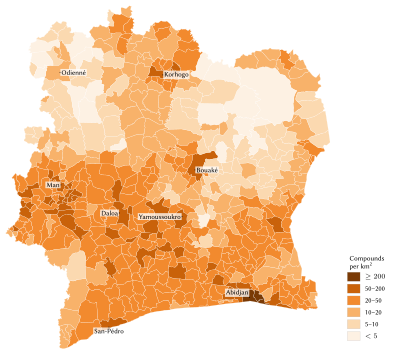
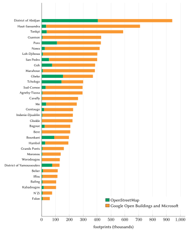
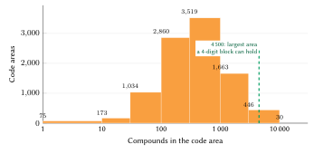
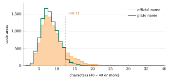
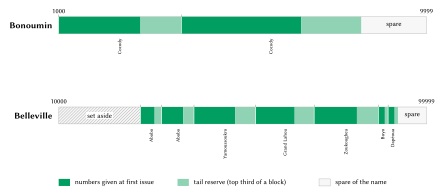
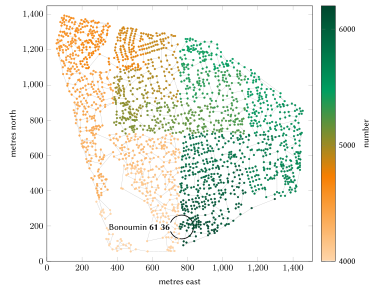
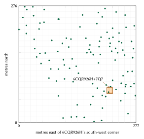

# Introduction

## The problem

The 2021 general census counted 29,389,150 residents in Côte d'Ivoire, 21.5 % of them in the District of Abidjan [@rgph2021]. Very few of them can write an address that a stranger could use to reach their door. Mail is delivered to post-office boxes identified by a two-digit office number, as in `06 B.P. 37 ABIDJAN 06`; home delivery was only ever tested [@upu2004civ]. Since 2017 the Ministry of Construction, Housing and Urban Planning (MCLU) has named streets and numbered gates across the District of Abidjan through the *Projet d'Adressage du District d'Abidjan* (PADA), whose metric house numbers and five-digit *code d'adresse* are now in use [@koaci2023numeros; @abidjanplanet2026]. The programme deliberately leaves out the precarious quarters, home to about a fifth of Abidjan's population [@fratmat2025fin], and the inland cities of the follow-on programme (PAVI) have not yet received addresses [@ci2024pavi]. Elsewhere, in the towns, villages and *campements* where most Ivorians live, a home is found by description and by telephone: "after the pharmacy, second alley on the left, the blue gate".

The cost of this is borne every day by delivery riders, ambulance crews, utilities, banks that must verify a customer's residence, and families sending goods to relatives. The international literature has long treated a working address as part of a country's basic infrastructure [@upu2012addressing; @farvacque2005; @un2017census], and it has also shown that addressing programmes decay when residents do not adopt the result [@farvacque2005].

## Contribution

This paper describes an addressing model built for Côte d'Ivoire and issued for the whole country. Its contributions are:

1. a code format, *place name + four or five digits read in pairs*, that is unique nationally on its own, with the arithmetic that makes it so (national name ranges cut into frozen blocks, Section 4.5);
2. a numbering of compounds along a Hilbert curve over each area, with reserved numbers for future infill (Sections 4.6 and 4.7);
3. a set of deterministic rules for turning long official place names into short *plate names* (Section 4.3) and for deciding which names are the same (Section 4.4);
4. a registry of 7,956,622 codes covering every compound visible in the available building data, an open reference engine, a deployable server that reproduces the issuer's answers, and conformance vectors (Section 5);
5. a measured evaluation of the issued registry (Section 6) and sourced estimates of its benefits for four groups of users (Sections 8 to 11).

The model complements the State's own work. Where PADA, and later PAVI, has given a gate an address, that address is the official one and is displayed first, exactly as the State writes it; the N-Ways code is shown beside it and serves to name the gate on the telephone and to distinguish the households of a *cour commune* behind one door.

## Structure of the paper

Section 2 reviews the existing postal, addressing and land systems of Côte d'Ivoire and the international practice. Section 3 describes the data. Section 4 sets out the model rule by rule, Section 5 its implementation and Section 6 its evaluation. Section 7 explains the designs we considered and rejected. Sections 8 to 11 examine the benefits for citizens, logistics and commerce, emergency services, and government. Section 12 covers privacy, safety and governance, Section 13 the limitations, and Section 14 concludes.

# Background and related work

## Postal delivery

The Universal Postal Union's addressing sheet for Côte d'Ivoire states that deliveries are made to post-office boxes and that the two-digit code of the post office must appear before and after the locality [@upu2004civ]. A home-delivery variant, in which the office code is preceded by a 1 (`104` for home delivery by office 04), was described as a test for a single building. We found no later description of a postal code. La Poste de Côte d'Ivoire has since introduced a digital post-office box and, with the national identification office (ONECI), the MaPoste application, which links a box to the national identity number; holding such a box became compulsory on 1 March 2026 [@osiris2026maposte; @gouv2026bulletin]. The same bulletin reports about 5,000 independent couriers enrolled on La Poste's POLI platform. La Poste has also promoted what3words, a proprietary location system, since 2016 [@laposte2016w3w]. None of these services gives a door an address.

## Street addressing in Abidjan

Street addressing in Abidjan has a longer history than is often assumed. The World Bank's review of addressing programmes in African cities between 1989 and 2004 records that Abidjan's ten municipalities were divided into 55 addressing zones, each identified by a letter, with even-numbered streets parallel to the coast and odd-numbered streets perpendicular to it ("Bd A5 Latrille" in Cocody), and that buildings were to receive metric numbers that were never applied [@farvacque2005]. The same review measured the cost of the 21 completed programmes it studied at US\$0.6 per inhabitant and US\$5.7 per addressed doorway, at 2005 prices.

PADA, the current programme, is run by the MCLU with World Bank financing; IGN FI, GEOFIT and Défis & Stratégies carried out the field work [@ignfi_pada]. Streets are named at three levels (boulevards, avenues and streets), validated by the District, the communes and the Council of Ministers. The house number is metric: the distance in metres from the start of the street, even on one side and odd on the other [@koaci2023numeros]. The official list of validated street names held about 11,450 streets with their identifier `ID_VOIE` in September 2025 [@mclu2025voies]. By 2026, 14,276 streets were named and 290,805 occupancy-unit plates installed, about 95 % of the target; street-sign installation was suspended in November 2025 to correct defects [@abidjanplanet2026]. The *code d'adresse* has five digits, three for the département and two for the commune, written after the street: "Hôtel de Ville, 495, BOULEVARD DE LA REPUBLIQUE, 00217", where 002 is Abidjan and 17 Le Plateau [@abidjanplanet2026]. The programme was budgeted at 12 billion FCFA [@fratmat2025fin] for 348,216 planned occupancy units [@koaci2025voies], about 34,500 FCFA per unit. PADA's address points are shared with partner institutions under a framework agreement signed in January 2023 [@aip2023convention; @fratmat2024base]; we found no open data or public lookup.

## The inland cities

The *Projet d'Adressage des Villes de l'Intérieur* (PAVI) completed its preliminary study for Yamoussoukro, Daloa and Korhogo in September 2024 [@ci2024pavi]; later reports add Bouaké and a target of fifteen regional centres by 2030 [@abidjanplanet2026]. No inland city had door-level addresses when this paper was written.

## Land identifiers

Parcels carry the unique identifier IDUFCI, twenty characters instituted by Decree 2019-221 [@decret2019221], final concession orders (ACD) in towns, and land certificates of the rural land agency AFOR under Law 98-750 [@afor]. The legal geodetic reference is ITRF2014 at epoch 2010.0 (Decree 2019-220) [@sigfu2023]. These identifiers designate land, not the gate at which a visitor stops; a parcel identifier changes when a parcel is split or merged. The model never uses them as addresses.

## International practice

The UPU's S42 standard describes the components of a postal address and the template in which a country combines them [@upu2017s42]; it does not prescribe how a country should create addresses where none exist. The UPU's survey of addressing, *Addressing the world*, argues that an address infrastructure is a public good and documents several national programmes [@upu2012addressing]. The World Bank's manual lays out the conventional method, naming streets and numbering doors in a municipal programme, and notes both its benefits for municipal finance and its main risk: an address that residents do not use is soon forgotten [@farvacque2005]. The United Nations census recommendations ask for permanent identification of streets and buildings, "which can be used for successive censuses and for other purposes", and observe that a listing of dwellings in dense places "cannot be made unless streets have names and buildings have unique numbers" [@un2017census, para. 3.116].

## Location codes

Two kinds of location code are in wide use. The Open Location Code, or Plus Code, encodes latitude and longitude in base 20 with an alphabet chosen to avoid words and confusable characters; a ten-character code locates a cell of about 14 m and an eleven-character code a cell of about 3 m, and a code can be shortened against a nearby town [@olc]. It is open and works offline. what3words names each 3 m square with three dictionary words [@what3words]; it is proprietary, and its words are those of a chosen language. Both codes identify a point rather than a home: they change if the reference point moves by a few metres, they do not distinguish two households at one gate, and they are difficult to dictate over the telephone in French, where letters such as W ("double vé") or Q are spelt out. We therefore use the Plus Code for points (Section 4.10) and not as the address of a home.

## The principle adopted: the official address first

The model follows one rule above all others: where the State has given a gate an address, that address is used and shown first, exactly as the State writes it. Every compound nevertheless carries an N-Ways code, because the official address does not cover the households of a shared courtyard and because a short code is easier to give on the telephone than a street name and a metric number. When PADA's address points are shared, or a resident confirms the plate on the gate, the official address is attached to the compound; no N-Ways code changes. The same rule will apply in PAVI towns. Everywhere else, which is most of the country, the N-Ways code is the address.

# Data and sources

**Building footprints.** The model starts from 9,478,857 building footprints inside the national boundary: 1,430,500 from OpenStreetMap [@haklay2008; @osm2026] and 8,048,357 from the machine-learned Google Open Buildings and Microsoft Global ML Building Footprints layers [@sirko2021; @openbuildings; @msbuildings], read through the Overture Maps distribution [@overture]. Figure 2 shows the share of each source by region: OpenStreetMap is strong in the District of Abidjan, Gbêkê, Tchologo, Poro and Bounkani, where volunteers have traced buildings, and the machine-learned layers provide almost everything elsewhere.

**Places.** Code areas are built on 10,220 named OpenStreetMap place nodes inside the country (quarters, neighbourhoods, villages, hamlets, localities, suburbs, towns and cities).

**Administrative units.** The machine form of a code rests on the 510 sous-préfectures of the CNTIG/OCHA common operational dataset [@hdx2018], identified by the six digits of their pcode (110301 is Bouaké), and on the ten historical communes of Abidjan, which receive the codes 010111 to 010120 inside the Abidjan sous-préfecture (010101): 520 units in all. Figure 1 maps the density of compounds by unit.

**Walls, fences and gates.** OpenStreetMap's closed walls, fences and hedges (2,652 of them enclose two or more buildings) and its gate nodes are used for grouping buildings into compounds (Section 4.11).

**Population and administration.** The census count is taken from the published results of the 2021 census [@rgph2021]; facilities used in Section 11 come from the same OpenStreetMap extract.

All inputs are open. The repository records every source with its licence and the date it was read (`SOURCES.md`), and the tools that turned the inputs into the registry are published with it [@nways_repo].

| Region | Compounds | Footprints | Median (m²) |
|:--|--:|--:|--:|
| District of Abidjan | 797,421 | 941,937 | 69.5 |
| Haut-Sassandra | 600,157 | 709,615 | 43.2 |
| Tonkpi | 491,515 | 588,017 | 36.5 |
| Guémon | 359,247 | 429,479 | 40.4 |
| Nawa | 353,610 | 418,343 | 45.1 |
| Poro | 349,550 | 427,470 | 35.3 |
| Lôh-Djiboua | 339,912 | 401,988 | 44.8 |
| San-Pédro | 338,405 | 400,569 | 45.0 |
| Gôh | 325,587 | 385,936 | 46.5 |
| Marahoué | 320,723 | 384,226 | 38.4 |
| Gbêkê | 306,189 | 370,186 | 50.8 |
| 21 other regions, Yamoussoukro | 3,374,306 | 4,021,091 | |
| **Côte d'Ivoire** | **7,956,622** | **9,478,857** | 45.5 |

: Compounds and footprints in the eleven largest regions.

{width=88%}

{width=80%}

# The model

## The forms of a code

A code has several forms, each for a different reader (Table 2).

| Form | Example | Used by |
|:--------------------------|:----------------------------------|:----------------------------------------|
| Remembered | **Bonoumin · 61 36** | people: said aloud, typed, written on a parcel |
| Written | Bonoumin 61 36 (Cocody) | plates, forms and messages; the commune is a label |
| Machine | CI-010114-083-6136-2 | information systems, QR codes; the last digit is the check |
| Structure, entrance | CI-010114-083-6136-2.2/1 | one building of the compound; one of its gates |
| Spot | 926H+7Q7 Cocody (6CQR926H+7Q7) | any point: its Plus Code |
| Official, where PADA numbered the gate | 495, boulevard de la République, 00217 | the State's address, shown first |

: The forms of one code.

Let $P$ be the plate name of the code area, $N$ its number of $n \in \{4, 5\}$ digits, $U$ the six-digit unit, $A$ the three-digit index of the area within its unit and $c$ the check digit. The remembered form is $P$ followed by "·" and the digits of $N$ grouped in pairs from the right (6136 becomes 61 36, 48480 becomes 4 84 80), the way Ivorians read telephone numbers. The written form adds the commune or sous-préfecture in brackets as a label. The machine form is `CI-`$U$`-`$A$`-`$N$`-`$c$. People never see, type or remember the check digit; it exists for systems, which verify it whenever they receive a machine form.

## Units and code areas

A *code area* is a named place that residents use, inside one unit. Each footprint $f$ is assigned to the nearest place point of its own unit $u(f)$, distances being measured on a local equirectangular projection:
$$
\operatorname{area}(f) = \operatorname*{arg\,min}_{a \in \mathcal{A}(u(f))} \sqrt{(\varphi_f - \varphi_a)^2 + \big((\lambda_f - \lambda_a)\cos\varphi_f\big)^2},
\tag{1}
$$
where $\varphi$ and $\lambda$ are latitude and longitude and $\mathcal{A}(u)$ is the set of areas of unit $u$. A footprint outside every unit polygon (11,865 of them, on the coast and along the borders) takes the nearest place point in the country. The 10,220 place points produce 9,834 areas, of which 9,800 contain compounds. The median area holds 382 compounds and the 90th percentile 1,870; the largest, the town of Bouaflé, mapped with a single place point, holds 23,047 (Figure 3).

Each area is frozen at first issue: its index, its blocks of numbers (Section 4.5) and its *frame*, the bounding box $(x_0, y_0, x_1, y_1)$ of its compounds' reference points widened by $0.0005°$ (about 55 m) on every side, over which its numbers are laid out (Section 4.6).

{width=85%}

## Plate names

Many official place names are too long to be said with a number: 1,395 of the 9,834 area names have more than twelve characters and 192 more than two words ("Échangeur Félix Houphouët Boigny (FHB)", "Cité Rosiers 6e Programme extension"). Each area therefore has two names: its official name, kept for display and search, and a *plate name* used in the code. A string $s$ is admissible as a plate name when
$$
\operatorname{plate}(s) \iff |s| \le 12 \;\wedge\; |W(s) \setminus L| \le 2 \;\wedge\; |W_{0\text{–}9}(s)| \le 1,
\tag{2}
$$
where $|s|$ counts characters after Unicode normalisation (an accented letter is one character), $W(s)$ is the set of words (a hyphen separates words), $W_{0\text{–}9}(s)$ the set of words that contain a digit and $L = \{$de, du, des, d', la, le, les, l', et, sur, en, au, aux, à$\}$ the linking words, which do not count.

A name that fails Eq. (2) goes through a fixed sequence of steps, and the first step that succeeds is taken: (i) a documented short form that residents already use, with its source ("Deux Plateaux" becomes **II Plateaux**, "Gonzagueville" becomes **Gonzague**); (ii) cleaning, which drops generic words such as Quartier, Cité, Lotissement, Campement or Résidence and text in brackets ("Cité Gestoci" becomes **Gestoci**); (iii) "Saint" becomes "St"; (iv) the most distinctive run of whole words, taken automatically only when the words dropped are generic or are the commune placed in front of a quarter ("Koumassi remblais" becomes **Remblais**). Anything else is left to the commune, with up to three candidates of which the first is used provisionally: Akan village names with two real parts ("Amian Kouassikro"), names whose last word changes the place ("Cité Angré Star 10"), and single long words ("Moritiendougou"). A short form that would read as a large city of the country or of the region is never taken automatically.

| Outcome | Areas |
|:--|--:|
| Official name already admissible | 8,378 |
| Cleaned | 212 |
| Abbreviated (St, Ste) | 2 |
| Documented short form | 2 |
| Most distinctive words | 44 |
| Left to the commune, first candidate used | 1,197 |
| of which still longer than Eq. (2) allows | 363 |

: How the plate names were obtained.

The 1,197 areas left to the commune carry a provisional plate name; 826,490 codes were issued with it, and a commune may replace it once. The official name always remains an alias (1,070 aliases are kept; four are dropped because two plate names would claim them), so that typing "Koumassi remblais 2966" finds **Remblais · 29 66**. An alias leads only to the area that carries it. Figure 4 compares the lengths of the official names and the plate names.

{width=85%}

## The name key

Two places have the same name if their plate names reduce to the same *name key*:
$$
\kappa(s) = \operatorname{join} \circ \operatorname{fold}_{\text{letters}} \circ \operatorname{fold}_{\text{words}} \circ \operatorname{drop}_{L} \circ \operatorname{split} \circ \operatorname{casefold} \circ \operatorname{unaccent}(s).
\tag{3}
$$
The steps are listed in Table 4. The letter folding reflects the way the same Akan, Mandé, Krou and Gur names are spelt in French: *Kouassikro* and *Kwassikro*, *Cocody* and *Kokody*, *Koffikro* and *Kofikro* have the same key.

| Step | Rule | Example |
|:------------------|:----------------------------------------------------|:------------------------------|
| unaccent, casefold | accents and case removed; œ becomes oe | Riviéra II → riviera ii |
| split | on anything but a–z and 0–9 | N'Guessankro → n guessankro |
| drop articles | le, la, les, l, de, du, des, d, et, au, aux | Les Lauriers → lauriers |
| fold words | st → saint, ste → sainte, pk and kilomètre → km, i to x → 1 to 10 | PK 18 = Kilomètre 18 → km 18 |
| fold letters | final s dropped (four letters or more); ou before a vowel → w; y → i; ph → f; qu, q → k; c before a, o, u → k; double letters single | Kouassikro → kwasikro |
| join | words joined | n guessankro → nguesankro |

: The steps of the name key, Eq. (3).

The folding can only merge names, never separate two spellings of one name: in case of doubt, names share a range. The 9,834 areas carry 8,618 distinct keys; 818 keys are shared by 2,034 areas holding 1,727,474 compounds. Akakro and Koffikro are each carried by 16 areas, Kouadiokro by 14 and N'Guessankro by 13; there are seven Madinas and seven Bellevilles.

## One national range per name

Every name key owns the numbers 1000 to 99999 nationally. For a key whose areas, taken in the frozen order of unit code and then area index, have $c_1, \dots, c_k$ compounds, each area receives a block of
$$
b(c) = \max\!\left(100,\; 100 \left\lceil \frac{2c}{100} \right\rceil\right)
\tag{4}
$$
numbers, twice its compounds rounded up to a hundred. With the allocation $B = \sum_{i=1}^{k} b(c_i)$ and the spare
$$
R = \max\!\left(500,\; \lceil 0.1\, B \rceil\right),
\tag{5}
$$
the name has
$$
n = \begin{cases}
4 & \text{if } B + R \le 9\,000 \quad (\text{blocks from } 1000),\\
5 & \text{if } B + R \le 90\,000 \quad (\text{blocks from } 10000),
\end{cases}
\tag{6}
$$
digits; a name that would need more than 90,000 numbers would take a qualifier (the name of its unit in front), which no name of Côte d'Ivoire requires. A five-digit name never uses the stretch $d0000$ to $d9999$ when the same name followed by the digit $d$ is also a name, so that a code typed without the dot can be read only one way among plate names (Section 4.8).

**Worked example: Bonoumin.** Two areas of Cocody share the name, with 1,468 and 2,193 compounds. Eq. (4) gives $b(1468) = 100 \lceil 29.36 \rceil = 3000$ and $b(2193) = 100\lceil 43.86 \rceil = 4400$, so the blocks are 1000–3999 and 4000–8399. Then $B = 7400$, $R = \max(500, 740) = 740$ and $B + R = 8140 \le 9000$: Bonoumin has four digits, and 8400–9999 is the spare for future areas of that name (Figure 5).

**Worked example: Belleville.** Seven areas with 31,339 compounds need 63,000 numbers, so Belleville has five digits. Because "Belleville 1" and "Belleville 2" are names too, Belleville does not use 10000–29999; its blocks run from 30000 to 92999 and its spare from 93000 to 99999 (Table 5, Figure 5).

| Area | Unit | Compounds | Block |
|:--|:--|--:|:--|
| Belleville | Abobo | 2,590 | 30000–35199 |
| Belleville | Abobo | 3,927 | 35200–43099 |
| Belleville | Yamoussoukro | 7,534 | 43100–58199 |
| Belleville | Grand-Lahou | 7,127 | 58200–72499 |
| Belleville | Zoukougbeu | 7,808 | 72500–88199 |
| Belleville | Buyo | 1,177 | 88200–90599 |
| Belleville | Dapéoua | 1,176 | 90600–92999 |
| *spare* | | | 93000–99999 |

: The national range of Belleville, the largest shared range.

{width=100%}

Of the 8,618 names, 8,295 have four digits and 323 five; 5,641,970 compounds (70.9 %) have a four-digit number and 2,314,652 (29.1 %) a five-digit one. A new area with an existing name, or an area whose block is full, takes the next block above every block of its name in the same digit space; a four-digit name whose space is used up continues in its five-digit space. Blocks never move, shrink or get renumbered.

## Numbering inside an area

Within its block, an area's compounds are numbered along a Hilbert curve [@hilbert1891] of order 16 laid over the frozen frame. The curve visits every cell of a $2^{16} \times 2^{16}$ grid once, and cells that are close on the curve are close on the ground; among the common space-filling curves it is the one that best preserves locality [@moon2001]. Neighbouring compounds therefore have neighbouring numbers, and a courier who has found Bonoumin 61 36 knows that 61 40 is close by. A compound's reference point, the area-weighted centre of its buildings until its gate is confirmed, at latitude $\varphi$ and longitude $\lambda$, falls in the grid cell
$$
g_x = \left\lfloor \frac{\lambda - x_0}{x_1 - x_0}\,(2^{16}-1) \right\rfloor, \qquad
g_y = \left\lfloor \frac{\varphi - y_0}{y_1 - y_0}\,(2^{16}-1) \right\rfloor .
\tag{7}
$$
Its position $h$ on the curve is accumulated over the scales $s = 2^{15}, 2^{14}, \dots, 1$, starting from $h = 0$:
$$
\begin{aligned}
&r_x = \left\lfloor g_x / s \right\rfloor \bmod 2, \qquad
r_y = \left\lfloor g_y / s \right\rfloor \bmod 2, \qquad
h \leftarrow h + s^2\,\big((3 r_x) \oplus r_y\big),\\
&(g_x, g_y) \leftarrow
\begin{cases}
(g_y,\, g_x) & \text{if } r_y = 0 \text{ and } r_x = 0,\\
(2^{16} - 1 - g_y,\; 2^{16} - 1 - g_x) & \text{if } r_y = 0 \text{ and } r_x = 1,\\
(g_x,\, g_y) & \text{if } r_y = 1,
\end{cases}
\end{aligned}
\tag{8}
$$
where $\oplus$ is the bitwise exclusive or. The $m$ compounds of an area with block $[\ell, u]$, sorted by $h$ and then by a stable identifier, receive
$$
N_i = \ell + i\,\delta, \qquad \delta = \max\!\left(1, \left\lfloor \frac{u - \ell + 1}{1.5\,m} \right\rfloor\right), \qquad i = 0, \dots, m-1,
\tag{9}
$$
so that gaps are left between neighbours wherever the block allows, and the top third of the block,
$$
T = \left[\ell + \left\lfloor \tfrac{2}{3}(u - \ell + 1) \right\rfloor,\; u\right],
\tag{10}
$$
is a tail reserve never used at first issue.

**Worked example: Bonoumin 61 36.** The compound's reference point is $\varphi = 5.3606529$, $\lambda = -3.9705867$, and Bonoumin's frame is $(x_0, y_0, x_1, y_1) = (-3.977501, 5.358897, -3.963872, 5.372010)$. Eq. (7) gives
$$
g_x = \left\lfloor \frac{0.0069143}{0.013629} \times 65\,535 \right\rfloor = 33\,247, \qquad
g_y = \left\lfloor \frac{0.0017559}{0.013113} \times 65\,535 \right\rfloor = 8\,775,
$$
and Eq. (8) gives $h = 3\,869\,755\,712$, the 2,137th position among the 2,193 compounds ($i = 2136$). With $\ell = 4000$, $u = 8399$ and $m = 2193$, Eq. (9) gives $\delta = \max(1, \lfloor 4400 / 3289.5 \rfloor) = 1$ and $N = 4000 + 2136 = 6136$; the tail reserve of Eq. (10) is 6933–8399. Figure 6 shows the whole area.

{width=78%}

## A new home

A compound built after issue, whose position $h$ falls between the issued numbers $a$ (at or before it on the curve) and $b$ (after it), takes the free number strictly between them that is nearest to their midpoint, the lower one on a tie:
$$
N^{*} = \operatorname*{arg\,min}_{N \in F,\; a < N < b,\; N \notin T} \left| N - \tfrac{a + b}{2} \right|,
\tag{11}
$$
where $F$ is the set of free numbers of the area's blocks. If no such number exists, it takes the lowest free number of the tail reserve $T$; when the block is full, it takes the first number of the next block of its name (Section 4.5). In Bonoumin the step is 1, so neighbours have consecutive numbers: a house built between Bonoumin 61 34 and 61 35 receives Bonoumin 69 33, the first number of the tail reserve. A new compound joins the area of the nearest issued code within 250 m, so that it takes its neighbours' name.

## Decoding without context

A code given without any commune is decoded by the set
$$
D(P, N) = \{\, a : \kappa(P) \in \{\kappa(a)\} \cup \operatorname{aliases}(a),\; N \in \operatorname{blocks}(a) \,\},
\tag{12}
$$
which has at most one element because the blocks of a name are disjoint. The text is read as a name and four or five digits, in pairs or not; the "·" fixes the boundary between name and number, and without it every split is tried, so that plate names ending in a number ("Koffikro 1 · 12 00") work. A check digit sent after a hyphen must verify, and a commune given in brackets or after a comma must be the area's unit or département; otherwise the code is refused rather than redirected.

The stretches skipped in Section 4.5 keep plate names from reading each other's numbers, but an official name typed instead of a plate name can also end in a digit. "Air France 1 10 00" is Air France 11000 in Korhogo, and also Air France I, the official name of the area France I in Bouaké, with the number 1000. When a text has several readings, a commune given with it keeps only the readings in that commune or département; then a reading through a plate name comes before a reading through an official name, because the plate name is the name on the code people hold, on the plate, the card and the written form; and only readings that still name two different codes are refused, with a request for the "·" or the commune. "Air France 1 10 00 (Korhogo)" and "Air France 1 10 00" are therefore Air France 11000, while "Air France I 10 00 (Bouaké)" and "Air France 1 · 10 00" are France I 1000. A number in no block, or in a name's spare, is reported as not issued and never guessed into a nearby place.

## The check digit

The machine form carries the check digit of Damm's algorithm [@damm2004; @damm2007], computed over the digits of the name key followed by the number. Writing the key as digits, each letter a–z as 10 to 35 and each digit 0–9 as 00 to 09, gives a string $d_1 d_2 \dots d_K$, to which the digits of $N$ are appended. With Damm's table $T$, a totally anti-symmetric quasigroup of order 10,
$$
c_0 = 0, \qquad c_k = T[c_{k-1}][d_k] \quad (k = 1, \dots, K + n), \qquad c = c_{K+n},
\tag{13}
$$
$$
T = \left(\begin{array}{cccccccccc}
0&3&1&7&5&9&8&6&4&2\\ 7&0&9&2&1&5&4&8&6&3\\ 4&2&0&6&8&7&1&3&5&9\\ 1&7&5&0&9&8&3&4&2&6\\ 6&1&2&3&0&4&5&9&7&8\\
3&6&7&4&2&0&9&5&8&1\\ 5&8&6&9&7&2&0&1&3&4\\ 8&9&4&5&3&6&2&0&1&7\\ 9&4&3&8&6&1&7&2&0&5\\ 2&5&8&1&4&3&6&7&9&0
\end{array}\right),
\tag{14}
$$
rows indexed by $c_{k-1}$ and columns by $d_k$, both from 0. A string followed by its check digit verifies when the recurrence ends in 0. Because $T$ is totally anti-symmetric, the check detects every single-digit substitution and every transposition of two adjacent digits [@damm2007], the two most frequent kinds of transcription error in Verhoeff's classic study [@verhoeff1969].

**Worked example.** The key of Bonoumin is *bonoumin*, which becomes 11 24 23 24 30 22 18 23; the number 6136 follows. The sequence of $c_k$ is
3, 7, 4, 0, 1, 2, 0, 5, 4, 6, 6, 6, 8, 0, 1, 2, 1, 0, 7, 2,
so $c = 2$ and the machine form is CI-010114-083-6136-2. The swapped number 6163 gives 8 and the substituted number 6137 gives 0, so both are refused. The name, not the area, enters the check: the area follows from the name and the number through the frozen blocks, so a slip that falls into another Bonoumin's block is caught as well, and a wrong unit or area index fails because that area does not own the number.

## Spot codes

Any point, a field, a lagoon bank or a crash site on a motorway, has a spot code: its Open Location Code [@olc]. With $\varphi' = \varphi + 90$ and $\lambda' = \lambda + 180$, the first ten characters are five pairs of base-20 digits from the alphabet `23456789CFGHJMPQRVWX`,
$$
\left(\left\lfloor \frac{\varphi' \bmod 20 r_j}{r_j}\right\rfloor,\; \left\lfloor \frac{\lambda' \bmod 20 r_j}{r_j}\right\rfloor\right), \qquad r_j \in \{20°,\ 1°,\ 0.05°,\ 0.0025°,\ 0.000125°\},
\tag{15}
$$
followed by an eleventh character from a $4 \times 5$ grid of the last cell (with $20 r_1$ read as $180°$ and $360°$ for the first pair). For Bonoumin 61 36, $\varphi' = 95.3606529$ and $\lambda' = 176.0294133$ give the digit pairs (4, 8), (15, 16), (7, 0), (4, 11) and (5, 15), that is 6C QR 92 6H 7Q, and the grid character 7: the code is `6CQR926H+7Q7`, a cell of about 2.8 m by 3.5 m (Figure 7). The code is written short against the nearest of the 520 units' reference towns, by the Open Location Code rule: four characters are dropped within $0.3°$ of the town, six within $0.015°$ and eight within $0.00075°$. Cocody's reference point is $0.024°$ away, so the short form is `926H+7Q7 Cocody`. Recovery prefixes the town's own leading characters and moves by one cell when the result lies more than half a cell away.

Because the town completes the short form, no two towns are written alike. Five names are the reference town of two units each (Lolobo, Santa, Nafana, Guézon and N'Guessankro, the last in two spellings), so each of these ten towns is written with its département in brackets, the way the country tells namesakes apart: `QHW6+44J Lolobo (Béoumi)`, never `QHW6+44J Lolobo`, which could also be recovered against Lolobo (Attiégouakro), 0.8° to the south. Accents, case and punctuation of the town do not matter. A short code typed with the bare town is recovered against every town of that name and kept only where the issuer would have written it: the town is, within $0.0001°$, the nearest reference to the recovered cell, and shortening the cell against it gives back the typed characters. If exactly one reading remains it is decoded, otherwise the code is refused; the true reading always passes this test, so the rule can refuse but never return a wrong cell. Only the town written after these codes is affected; the Plus Code itself, and every code, number and check digit, are those issued.

{width=68%}

## Compounds

The unit of the address is the compound (the plot or *cour*), not the building, because a visitor needs the gate. Footprints are grouped into compounds one area at a time, after sorting them by a stable identifier, by the rules of Table 6, where the distance between two footprints is
$$
\operatorname{dist}(a, b) = \min_{p \in \partial a,\; q \in \partial b} \lVert p - q \rVert,
\tag{16}
$$
the shortest distance between their outlines, zero when one touches or overlaps the other.

| Rule | Condition | Effect |
|:--------------|:----------------------------------------------|:----------------------------------------|
| Enclosure | the footprint's centre lies inside a mapped closed wall, fence or hedge of 40 to 6,000 m² | the enclosure is one compound |
| Estate | inside a larger enclosure: an estate, a government, military or police site | a parent; the compounds inside keep their own codes |
| Annex | a footprint smaller than 25 m² (kitchen, shower, guard post) | joins the nearest footprint of at least 25 m² within 5 m by Eq. (16) |
| Single | any other footprint | its own compound |

: Grouping rules.

Only annexes join, and only to a building of at least 25 m², so two houses are never joined and nothing chains. The result is 7,956,622 compounds from 9,478,857 footprints, 1.19 footprints per compound: 6,670,716 single, 1,282,106 with their annexes and 3,800 from mapped walls; 6,671,864 compounds have one structure, 1,089,065 two, 164,804 three and 30,889 four or more. Merging two codes later costs a household nothing, whereas splitting a wrong merge would give one household a new code; the rules are conservative for that reason, and residents' answers in the application ("these buildings are one house", "here is the gate") complete them.

## The building profile

Every structure carries a use class with its confidence and source, its size, its number of floors where known and a status. The classes reflect Ivorian building types: residential (villa, *cité* housing, apartment block, *cour commune*, *baraque*, *case*), commercial (*boutique*, *maquis*, market, fuel station, bank, pharmacy), office, government, education, health, religious, hospitality, transport, industrial, agricultural, annex, under construction and ruin. They are inferred in a fixed order: the OpenStreetMap building type (confidence 0.85), an amenity, shop, office or tourism tag on the footprint (0.75), a mapped place inside it (0.65), the footprint's size (0.3 to 0.4), and otherwise residential by default (0.45). Ninety-nine per cent of the 9,478,857 classes are still the default; OpenStreetMap gives floors for 4,035 buildings. The heights of the machine-learned footprints take only 36 distinct values between 3.5 and 7 m and are not used. A home never carries a name.

# Implementation

## The reference engine

The normative rules are written in `engine/SPEC.md` and implemented in a reference engine in Python using only the standard library (`engine/reference/ci_engine.py`), together with the plate-name rules (`plate_names.py`). The engine parses every form of a code, computes the name key and the check digit, encodes and decodes Plus Codes, finds the unit and area of a point and reproduces the numbering of Eqs. (7) to (11). It ships with the frozen register (`engine/data/register.json`: 520 units with their reference towns, 8,618 names with their blocks, 9,834 areas with their plate names, official names, blocks and frames, and 1,070 aliases) and the national boundary, a few megabytes in all, so that a decoder can run offline on a telephone.

## The registry

The registry (`registry/`) holds every issued code, one gzip-compressed CSV file per unit and the frozen area table `areas.csv.gz`. Each row gives the machine, remembered and written forms, the zone and official name, the number and check digit, the status (`provisional` until residents confirm it), how and when it was issued, the entrance position and kind, the Plus Code, any official address, the use class, kind, structures and floor area, and the grouping rule. A manifest (`MANIFEST.json`) gives the number of codes per unit and the SHA-256 digest of every file uncompressed. The registry is published in full and is the same for every quarter.

## The server and its API

The repository includes a server (`server/`) that anyone, a ministry, a post office or a developer, can deploy with one command (`docker compose up`). It is written in standard-library Python with SQLite and reuses the reference engine. Its `import` command streams the registry into a database, verifying every file against the manifest and refusing any mismatch; its `export` command writes the registry back in the published format, and an export of an imported registry is byte-identical to the published files once uncompressed. The JSON API under `/v1` answers the full card of a code, search by any form (remembered, written, machine, official address or spot code), the code at a point and the codes near it, verification of a machine code, spot-code encoding and decoding, and the units, areas and codes of each zone. An issuing deployment adds `POST /v1/codes` and `PATCH /v1/codes/{machine}`, which apply the issuer's rules: a point within 3 m of an issued entrance already has a code; an outline must enclose 6 to 20,000 m²; a further door must lie within 80 m of its compound; a new compound joins the area of the nearest code within 250 m; and its number is given by Eq. (11). The API is specified in OpenAPI 3.1 (`server/openapi.yaml`) and documented with real requests and responses (`docs/api.md`).

Only one issuer may exist per country: two issuers working from the same registry would give the same number to two different compounds. A deployment therefore runs read-only unless the State or N-WAYS LIMITED has designated it as the issuer.

## Conformance

Ports of the engine must reproduce two sets of vectors: `engine/reference/vectors.json` (625 name keys, 500 code forms, 2,812 lookups, 400 spot codes, 120 short spot codes written against a town whose name another unit's town shares, numbering, extension blocks, Hilbert positions, block sizes and digit pairs, computed on the frozen register) and `engine/reference/test_vectors.json` (real points, the public Open Location Code test cases, Damm checks, names that must share or must not share a range, numbers that are not issued, and alias cases). The engine's 40 unit tests and the server's 28 tests run on every change, and `tools/check-decoding.py` decodes every issued code of the registry from each of the forms people hold. The server's tests include 310 sequential issues computed by the issuer's own engine on five fixture areas, including blocks that fill up and take an extension block; the server reproduces every number and form.

# Evaluation

We measured the issued registry as published, with a script included in the repository (`tools/paper-evaluation.py`), reading every one of the 7,956,622 rows once. Decoding and slip measurements use a fixed random sample of 100,000 codes (seed 2026).

## Conformance, coverage and uniqueness

Every row agrees with the reference engine: its number lies in its area's blocks, its check digit is that of Eq. (13), and its remembered and written forms and its Plus Code are those the engine writes (0 failures). All 7,956,622 machine forms are distinct, and so are all 7,956,622 pairs $(\kappa(P), N)$: the remembered form identifies one compound in the whole country. Every compound in the input data has a code; the registry's coverage is bounded only by the coverage of the footprints (Section 13).

## Lengths

| Measure | Value |
|:--|--:|
| Codes with a four-digit number | 5,641,970 (70.9 %) |
| Codes with a five-digit number | 2,314,652 (29.1 %) |
| Remembered form, mean length | 16.4 characters |
| Remembered form, shortest and longest | 10 and 34 characters |
| Short spot code of 8 characters (plus town) | 6,330,711 (79.6 %) |
| Short spot code of 6 or 4 characters | 1,625,532 (20.4 %) |
| Full spot code (no town within 0.3°) | 379 |

: Lengths of the issued codes.

The longest remembered forms belong to the provisional names of areas left to their commune; among the others the longest is "Soungalovogo · 1 00 00", 22 characters. Four digits form two chunks, well within the three to five chunks that short-term memory holds [@cowan2001].

## Decoding

We decoded each form of every sampled code without any other information and counted how often the decoder returned the code it came from (Table 8).

| Form decoded | Sample | Decoded to the same code |
|:--------------------------------------------------|--------------------:|------------------------------:|
| Remembered (with "·") | 100,000 | 100,000 (100 %) |
| Machine | 100,000 | 100,000 (100 %) |
| Written (no dot, commune in brackets) | 100,000 | 100,000 (100 %) |
| Short spot code, recovered within 3 m of the entrance | 100,000 | 100,000 (100 %) |

: Round trips on the random sample.

Every sampled code comes back from each of its forms, and a pass over the whole registry (`tools/check-decoding.py`) decodes all 7,956,622 remembered forms, written forms and short spot codes with their towns to their own code and cell. Two rules of Section 4 carry this result where a text could be read two ways. For 6,840 codes of Air France (0.09 %), in Korhogo and Man, the written form without the "·" also reads as Air France I or Air France II, the official names of France I and France II in Bouaké, followed by four digits; the plate-name reading comes first, and the commune in brackets agrees with it (Section 4.8). And 79,412 codes (1.0 %) are written against one of the ten reference towns that carry their département because another unit's town has the same name (Section 4.10); without the département, a decoder could not tell the two Lolobos apart. The median recovery error of the short spot codes is 1.2 m and the 99th percentile 2.1 m, within the 11-character cell.

## Slips in the number

For each sampled code we formed every single-digit substitution of its number and every transposition of two adjacent, distinct digits (keeping a leading digit non-zero), and classified the result.

| Slip | Variants | Another home | In a block, unissued | Outside the blocks | Detected |
|:------------------|--------------:|------------------:|------------------:|------------------:|--------------:|
| Substitution | 3,759,209 | 71.8 % | 10.3 % | 17.9 % | 100 % |
| Adjacent transposition | 272,996 | 67.8 % | 14.0 % | 18.1 % | 100 % |

: What a single slip in the number would do, and what the check digit catches.

Of the substitutions, 2,699,858 reach another issued home, 387,447 fall in a block on an unissued number and 671,904 outside every block; of the transpositions, 185,202, 38,246 and 49,548. Because the blocks are dense, about seven slips in ten would send a visitor to a real but wrong home. This is the measured justification for a check digit in every machine form: a system that receives `CI-010114-083-6163-2` instead of `CI-010114-083-6136-2` refuses it. Let $p_{\text{wrong}}$ be the probability that an unchecked slip reaches another home; with a check digit that detects all single substitutions and adjacent transpositions, the residual probability for these slips is
$$
p_{\text{wrong}}^{\text{checked}} = p_{\text{wrong}} \times \Pr[\text{undetected}] = 0.718 \times 0 = 0,
\tag{17}
$$
leaving only rarer errors, such as two independent slips, of which a decimal check digit misses about one in ten.

## National ranges against per-area numbering

To measure what the national ranges buy, we numbered every area on its own from 1000 with the same block and step rules, Eqs. (4) and (9). Under that counterfactual, 991,213 codes (12.5 %) would share their remembered form with a code of another area of the same name, and each would need its commune to be understood. Under the national ranges the number is zero, at the price of a fifth digit for 29.1 % of compounds rather than for the 21.1 % that live in areas too large for a four-digit block in any case (230 areas with more than 4,500 compounds, holding 1,681,123 compounds).

## Grouping

We re-ran the grouping rules with the 2,652 mapped walls and fences that enclose two or more buildings hidden from them, and compared the result with the enclosures. 4.5 % of the enclosures come out whole (4.0 % exactly) and a further 34.1 % miss a single building. Behind an Ivorian wall, the main house, the boys' quarters and the tenants' rooms are separate buildings several metres apart; without a mapped wall the rules keep them apart on purpose (Section 4.11). Compound grouping is therefore the least certain part of the registry, and the one that residents' confirmations are designed to correct.

## Codes near well-known places

| Near | Remembered | Machine | Spot |
|:------------------|:------------------------|:------------------------------|:--------------------------|
| Riviera, Cocody | Bonoumin · 61 36 | CI-010114-083-6136-2 | 926H+7Q7 Cocody |
| Hôtel de Ville, Le Plateau | Le Plateau · 1 13 10 | CI-010116-002-11310-8 | FH+RQX Le Plateau |
| Treichville market | Zone 2b · 11 21 | CI-010119-010-1121-2 | XR+JJ5 Treichville |
| Abobo station | Abobo RTI · 29 21 | CI-010111-035-2921-0 | 9J+59F Abobo |
| Koumassi Remblais | Remblais · 29 66 | CI-010115-005-2966-3 | 2P+565 Koumassi |
| Adjouffou, Port-Bouët | Adjouffou · 4 84 80 | CI-010118-021-48480-1 | 63VH+FJ5 Port-Bouët |
| Bouaké, central market | Bouaké · 25 45 | CI-110301-096-2545-5 | Q9+RQV Bouaké |
| Basilica, Yamoussoukro | Petit Bouaké · 11 15 | CI-020201-031-1115-9 | RP63+F6V Yamoussoukro |
| Korhogo | Korhogo · 1 08 32 | CI-280201-041-10832-8 | 5C+654 Korhogo |
| Man | Man · 1 15 98 | CI-320301-023-11598-4 | 6W+XCV Man |
| Grand-Bassam, Quartier France | France · 17 51 | CI-300303-031-1751-2 | 57W6+JWR Grand-Bassam |
| San-Pédro port | Mohikrakro · 21 22 | CI-290101-041-2122-1 | P9VG+GRR San-Pédro |

: Issued codes of the compound nearest to well-known places.

The national ranges make repeated names harmless. `Madina 30 00` lies in the block 2800–3799, the Madina of Sarhala; `Madina 40 00` is in Sokoro, 3800–4799; the two Madinas of Korhogo hold 5000–5499 and 5500–6199. "Madina 30 00, Korhogo" is refused, because Madina 30 00 is in Sarhala: a commune never redirects a code.

# Designs considered

## Forms of the code

We compared the forms in Table 11 on four criteria: whether the code can be dictated in French on the telephone, whether it can be remembered after hearing it once, whether it is unique without context, and whether it survives a reform of the communes.

| Form | Example | Dictation | Memory | Unique alone | Survives reform |
|:--------------------|:--------------------|:----------------|:----------------|:--------------|:--------------|
| Short Plus Code | 926H+7Q7 Cocody | hard: letters and a plus | hard | with its town | yes |
| what3words | three words | easy in English | medium | yes | yes, proprietary |
| Commune and number | Cocody 274 117 | easy | hard: six digits | yes | no |
| National digits | 01011408361362 | easy | hard; resembles the *code d'adresse* | yes | no |
| Place name, number, commune | Sicogi 48 17, Yopougon | easy | medium | only with the commune | no |
| **Place name and number, national range** | **Bonoumin · 61 36** | **easy, in pairs** | **easy** | **yes** | **yes** |

: Forms of the code compared.

*Commune and number.* Cocody alone has 140,412 compounds; numbered by commune it would need six digits, since $2 \times 140\,412 > 99\,999$, and a code that contains the commune is made obsolete when a commune is split or created. *National digits* would be fourteen meaningless digits that could be mistaken for PADA's numeric *code d'adresse*. *Letters* such as those of the Plus Code alphabet are spelt out in French ("double vé" for W) and need several key presses on a basic keypad. *A place name with the commune to separate repeats* was the strongest alternative, but a code read on the telephone or written on a parcel often travels without its commune, and Côte d'Ivoire repeats place names widely (Section 4.4); the evaluation of Section 6.5 measures 991,213 codes that would then be ambiguous. *Full official names* ("Échangeur Félix Houphouët Boigny (FHB) 1150") are too long to be said with a number. The chosen form costs a fifth digit for some places and nothing else.

## The check symbol

A check character that detects every single substitution and every adjacent transposition requires either an alphabet of eleven symbols with a prime modulus, which brings back a letter, or a decimal scheme based on a group or quasigroup, such as Verhoeff's [@verhoeff1969] or Damm's [@damm2007]. Damm's scheme needs a single $10 \times 10$ table and no permutation, and its digits read the same in every language. Entering the name key rather than the area index into the check extends the guarantee across all the areas of one name.

## The numbering order

A number should tell a visitor roughly where the next number is. We compared the issued Hilbert order with two alternatives applied to the same compounds of every area: the Z-order (Morton) curve on the same $2^{16} \times 2^{16}$ grid, and serpentine rows 100 m high, numbered west to east and then east to west. Table 12 gives the distance on the ground between consecutive numbers, over all 7.9 million consecutive pairs.

| Order | Median | Mean | 90th percentile | Pairs more than 200 m apart |
|:----------------------------|------------------:|------------------:|------------------:|------------------:|
| **Hilbert (issued)** | **20.0 m** | **66.0 m** | **75.4 m** | **5.4 %** |
| Z-order (Morton) | 22.4 m | 85.6 m | 112.4 m | 6.6 % |
| Serpentine rows of 100 m | 29.9 m | 132.3 m | 84.0 m | 6.1 % |

: Distance between compounds with consecutive numbers under three orders.

The Hilbert curve, which has the best locality of the common space-filling curves [@moon2001], gives the shortest steps on every measure; the long tail of all three orders comes from large rural areas whose compounds are scattered; the Z-order curve makes long jumps at the boundaries of its quadrants, and rows place the two ends of each row far apart at every turn. The quadrant structure is visible in Figure 6, where consecutive numbers stay within one quarter, then one sixteenth, of the area.

## Areas from streets

Street-based addressing, the method of PADA and of the programmes reviewed by the World Bank [@farvacque2005], requires named streets. Outside the PADA perimeter we found very few: in the Abidjan extract only 9,101 of 46,091 OpenStreetMap highway ways carry a name. Building the model on place names, which every resident uses, removes that dependency and leaves the street address to the State's programmes.

# Benefits for citizens

For a family in a *cour commune* of Abobo, in a *campement* near Soubré or in a new house in Songon, the code changes four ordinary things.

**Being found.** Today a visitor, a taxi or a delivery rider is guided by telephone, landmark by landmark. With a code, the resident says one short phrase, "Bonoumin, soixante-et-un, trente-six", and the visitor's telephone leads to the gate.

**Proving where one lives.** Banks, mobile-money agents, schools and employers ask for an address. Outside the PADA streets almost nobody can write one that anyone can check (Table 13).

| | Compounds | Share |
|:--|--:|--:|
| With a PADA house plate (District of Abidjan) | at most 290,805 plates | at most 3.7 % |
| With an N-Ways code | 7,956,622 | 100 % |

: Who can give a verifiable address.

**Receiving goods and services.** Relatives abroad, shops, and water and electricity services can deliver to a code rather than a description, and a household can ask for a connection or a repair at the right gate.

**No burden.** Nothing is asked of the household. Every compound visible in the data had its code from 20 October 2026; the code is free, needs no document and holds no personal data. It is an address and not a land title.

The people who benefit most are those with the least today: families in the precarious quarters that PADA excludes, villages and *campements* far from any landmark, the tenants of a *cour* who share one door, and those who do not read French easily, for whom a familiar place name and two pairs of digits are easier than a street name.

# Benefits for logistics and commerce

Delivery in Côte d'Ivoire is organised by telephone. The UPU's econometric analysis of postal operators finds that improving address accuracy raises the rate of successful first delivery attempts by a median of 5.4 % and by up to 23 % for the operators that gain most, while poor address quality lowers it by up to 14 % [@upu2025brief]. An industry analysis of African last-mile delivery puts first-attempt success as low as 60 % for many courier companies and the average cost of one attempt at about US\$2.70 [@nextbillion2023]. We estimate the saving per 1,000 deliveries as
$$
S = V \, \Delta p \, c_a ,
\tag{18}
$$
where $V = 1000$ is the number of deliveries, $\Delta p$ the gain in first-attempt success (avoided repeat attempts) and $c_a$ the cost of an attempt. Reading the UPU's median as 5.4 percentage points and taking $c_a = \text{US\$}2.70$ gives $S \approx \text{US\$}146$ per 1,000 deliveries (Table 14). These figures are international estimates applied to Côte d'Ivoire, not measurements made there.

| $\Delta p$ | Assumption | Saving per 1,000 deliveries |
|:--|:--|--:|
| 2 points | the UPU's moderate performers | US\$54 |
| 5.4 points | the UPU's median | US\$146 |
| 10 points | half the gap between 60 % and 80 % success | US\$270 |
| 23 points | the UPU's best performers | US\$621 |

: Sensitivity of Eq. (18) to the gain in first-attempt success ($c_a$ = US\$2.70).

**What the code gives a business.** The machine form is a stable key for a customer's compound; it resolves to the gate, or to the main building until the gate is confirmed; its check digit catches a mistyped code at once; and every code carries the gate's Plus Code, readable by any Plus Code application. The registry and the engine are open, so that any business can resolve codes in its own systems, offline, without paying for access.

**Markets, ports and farms.** The markets of Adjamé and Treichville, the ports of Abidjan and San-Pédro and the cocoa and cashew collection points can direct goods and payments to a compound by its code, and a cooperative can list its members' compounds by code rather than by village alone. La Poste's network of about 5,000 POLI couriers [@gouv2026bulletin] gains a door to go to for each digital box.

# Benefits for emergency services

An ambulance, a fire crew or a police patrol faces the courier's problem with more at stake. A qualitative study of emergency medical services in Kigali found that crews and dispatchers lost time locating patients because they relied on local knowledge and needed several calls to pass on a location [@hunt2023]. Côte d'Ivoire's emergency numbers, 185 for medical assistance, 180 for the fire service and 110, 111 or 170 for the police [@gac_emergency], receive locations in the same way; we know of no published measurement of the time Ivorian services take to locate a caller, which is itself a reason to start measuring it (Section 13).

**How a code helps a dispatcher.** The caller says one phrase ("Madina, trente, zéro zéro"); the registry returns one compound, in Sarhala, not one of the six other Madinas; the dispatcher reads back the place, its sous-préfecture and the gate; the crew drives to the gate; a Plus Code marks any point without a compound, such as a crash on the Abidjan–Yamoussoukro motorway; and all of this works offline.

**What a minute is worth.** For witnessed out-of-hospital cardiac arrest with ventricular fibrillation, Larsen and colleagues estimated survival as 67 % less 2.3 points for each minute before cardiopulmonary resuscitation, 1.1 points for each minute before defibrillation and 2.1 points for each minute before advanced care [@larsen1993]. Where one crew brings all three, a delay $\Delta t$ in finding the gate costs
$$
\Delta S = (\beta_{\text{CPR}} + \beta_{\text{def}} + \beta_{\text{ACLS}})\,\Delta t = (2.3 + 1.1 + 2.1)\,\Delta t = 5.5\,\Delta t \ \text{points of survival},
\tag{19}
$$
so that one minute saved is worth about 5.5 points and two minutes about 11, within the range of the model ($\Delta S$ cannot exceed the 67 % baseline). This applies to a narrow group of patients and to a linear model fitted elsewhere; for emergency patients in general, a large cohort found no survival benefit from response times under eight minutes except within four minutes for the most severely ill [@pons2005]. We give Eq. (19) as an order of magnitude for the most time-critical calls, not as a prediction.

# Benefits for government coordination and planning

**One reference for all services.** When ministries, communes, utilities and the Institut National de la Statistique refer to a compound by the same code, their records can be joined without matching names and descriptions. An address directory gives a list of premises more complete than a tax roll and shows who is missing from it [@farvacque2005]. In Abidjan, the registry and PADA's addresses can be compared gate by gate once they are shared, and each PADA address attached to a compound makes both more complete.

**What a door-numbering survey would have cost.** At the cost per addressed doorway measured by the World Bank, a conventional programme covering every compound would have cost
$$
C = N_c \, c_d = 7\,956\,622 \times \text{US\$}5.7 \approx \text{US\$}45.4 \text{ million}
\tag{20}
$$
at 2005 prices, where $N_c$ is the number of compounds and $c_d$ the cost per doorway [@farvacque2005]. The same review reports US\$7.6 per doorway for another national programme, which gives US\$60.5 million; neither figure includes street naming or signs, nor the inflation since 2005. These amounts measure the field survey that the model replaces; they do not replace PADA's street names, which serve purposes the code does not.

**A code that outlives reforms.** Communes and sous-préfectures are labels looked up from a compound's position. When a commune is created or split, every code keeps working and shows its new commune; the unit in the machine form never moves.

**The census.** The United Nations recommendations ask for permanent identifiers of buildings usable in successive censuses [@un2017census]. A table linking codes to the census enumeration areas would give the next census a frame of 7,956,622 compounds to sample from and return to, and would give the registry household counts, without storing any name.

**Access to services.** Straight-line distances from a random sample of 20,000 compounds to the nearest mapped facility are given in Table 15.

| Facility | Within 2 km | Within 5 km | Median distance |
|:--|--:|--:|--:|
| Health facility | 27.8 % | 36.0 % | 9.7 km |
| School | 34.0 % | 42.6 % | 7.2 km |
| Police | 17.9 % | 27.0 % | 18.1 km |
| Pharmacy | 25.6 % | 32.8 % | 12.1 km |

: Distance from compounds to the nearest mapped facility (20,000 random compounds, OpenStreetMap facilities).

These figures say as much about the map as about the country: village schools, health posts and gendarmeries are thinly mapped. A ministry can replace the facility list with its own and recompute them in minutes from the open registry.

# Privacy, safety and governance

**Places, never people.** Codes describe places. Homes carry no names and no occupant data; business and public buildings carry their public names. No identity number is collected, and nothing links a code to the national identity number or to a MaPoste box. Law no. 2013-450 on the protection of personal data applies, with ARTCI as the supervisory authority [@dlapiper]; the declarations and authorisations the law requires for the personal data that the N-Ways application processes (telephone numbers, photographs) are filed through ARTCI's CERTINUM platform [@dmf2026certinum]. Photographs sent with a new home are kept for verification only and never published.

**The registry is public and the same everywhere.** The registry is published in full and is identical for every quarter, including quarters announced for demolition. It holds nothing about the people who live there; requests about people are answered only on a court order, with a public report. An address is neither a right of occupation nor a list for eviction, and the application says so.

**Confirmation by residents.** Every code starts as provisional. It becomes confirmed when residents agree in the application: two telephones, at least one at the gate, with most answers on their side. No code waits for a manual review.

**One issuer.** N-WAYS LIMITED maintains the model and issues the codes, so that no two homes share a code. Areas, blocks and frames are frozen, codes are never moved and a retired number is never reused; regrouping buildings never changes an issued code. A commune may rename an area (the old name remains an alias), choose a provisional short name once, or add areas. PADA's and PAVI's addresses belong to the State: they are shown as written, never edited, and any mismatch observed on the ground is reported to the MCLU. The repository, the registry and the rules are designed to be handed to the State or to a body it designates, under the open licences, without forking the engine.

# Limitations and future work

**Places.** OpenStreetMap place points are uneven; names and spellings need confirmation by residents and communes, and towns mapped with a single point (Bouaflé, Soubré) form very large areas with five-digit numbers. Since areas are frozen, a refinement adds new areas for new compounds and aliases for names.

**Provisional plate names.** 1,197 plate names, of which 363 exceed the limit of Eq. (2), are provisional until the communes choose.

**Compounds and uses.** Compounds are inferred: few walls are mapped, and most compounds are a single building or a house and its annexes (Section 6.6). Uses are a default for 99 % of structures, and floors are almost always unknown. Gates are rarely known, so most codes lead to the main building until a gate is confirmed.

**Coverage.** A compound absent from all three footprint sources has no code until it is added; a house too new for the imagery receives a code on the spot when a resident adds it, by Eq. (11).

**Official data.** PADA's address points are not open; until they are shared, the official address is attached only where residents confirm it. The unit codes of the machine form are the CNTIG/OCHA pcodes, kept even when an official codification is published, which would then be recorded beside them.

**What we will measure.** The model rests on assumptions that only field measurement can test. We propose the measures in Table 16.

| Measure | Method | Target |
|:----------------------------------|:----------------------------------------|:--------------------------|
| Recall of one's own code after one week | residents asked without the application, in French, Dioula and Baoulé | at least 80 % exact |
| Digit errors when dictating a code | recorded calls with partner couriers | under 5 % |
| First-attempt delivery success | partner couriers, with and without a code | at least 20 points higher |
| Time from arrival in the quarter to the gate | courier application timestamps | halved |
| Gates confirmed and PADA addresses attached | residents and couriers | 50,000 |

: Field measurements proposed.

# Conclusion

Côte d'Ivoire can give every home an address without first naming every street. A place name that residents already use, a number of four or five digits read in pairs, and a national range per name are enough to make the code unique in the whole country; a Hilbert curve keeps neighbours' numbers close; a Damm check digit protects the machine form against the slips that would otherwise send seven visitors in ten to the wrong door; and an Open Location Code locates any point. The registry of 7,956,622 codes, its engine and a server that reproduces the issuer's answers are open, so that the State, a post office or a company can deploy them and obtain identical results. Where the State has numbered a gate, its address remains the address and comes first; everywhere else, which is most of the country, the code gives a home an address that can be said, written, checked and found.

# Data and code availability {-}

The specification, reference engine, registry, server, tools, figures and this paper are available at <https://github.com/n-ways/open-addresses-cote-divoire> [@nways_repo]. Code is licensed under the Apache License 2.0, data under the Open Database License 1.0 and documents under CC BY 4.0. Every use should credit "N-Ways Addressing for Côte d'Ivoire, © N-WAYS LIMITED (nways.ng)". The figures are produced from the published data by `tools/paper-figures.py` and the evaluation by `tools/paper-evaluation.py`.

# Acknowledgements {-}

The registry is derived from OpenStreetMap (© OpenStreetMap contributors, ODbL), Google Open Buildings (CC BY 4.0), Microsoft Global ML Building Footprints (ODbL, through Overture Maps) and the sous-préfecture boundaries of the CNTIG and OCHA (CC BY-IGO). We thank the volunteers who map Côte d'Ivoire, and the public bodies whose published documents on PADA, PAVI, land and postal services made the review of existing systems possible.

# References {-}

::: {#refs}
:::
